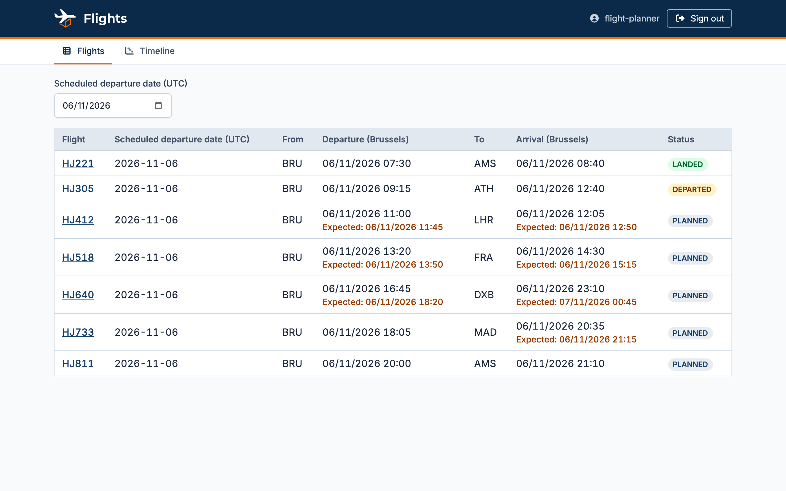
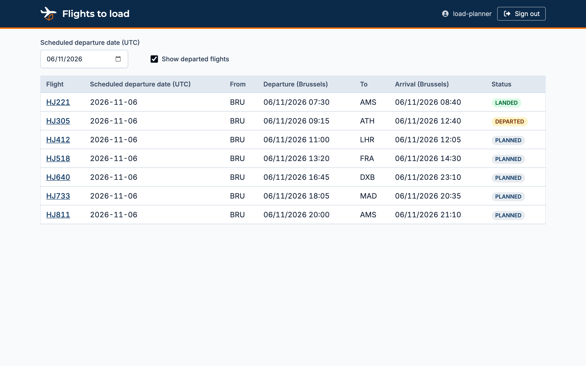
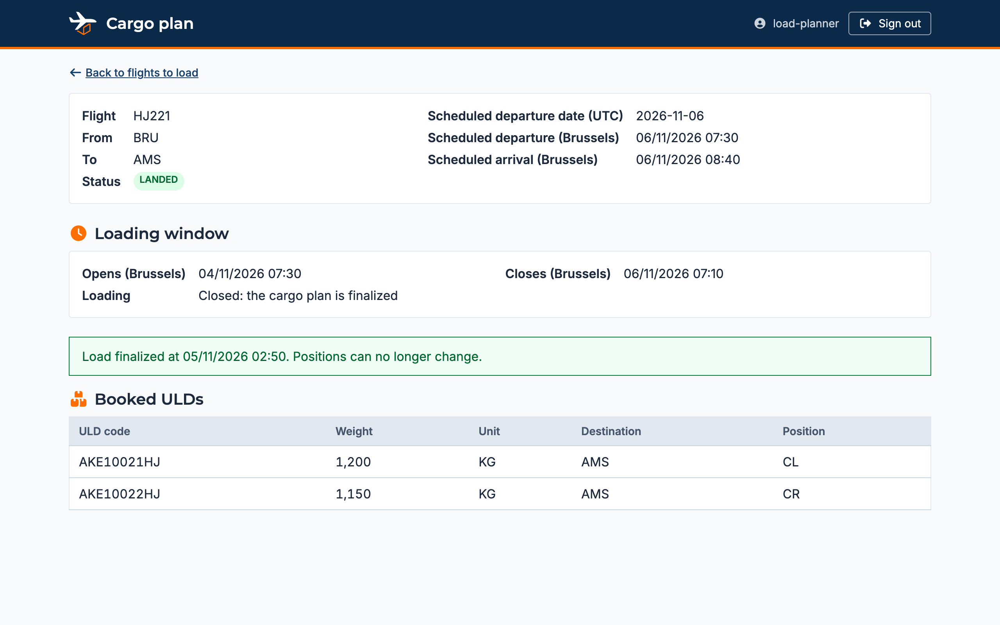
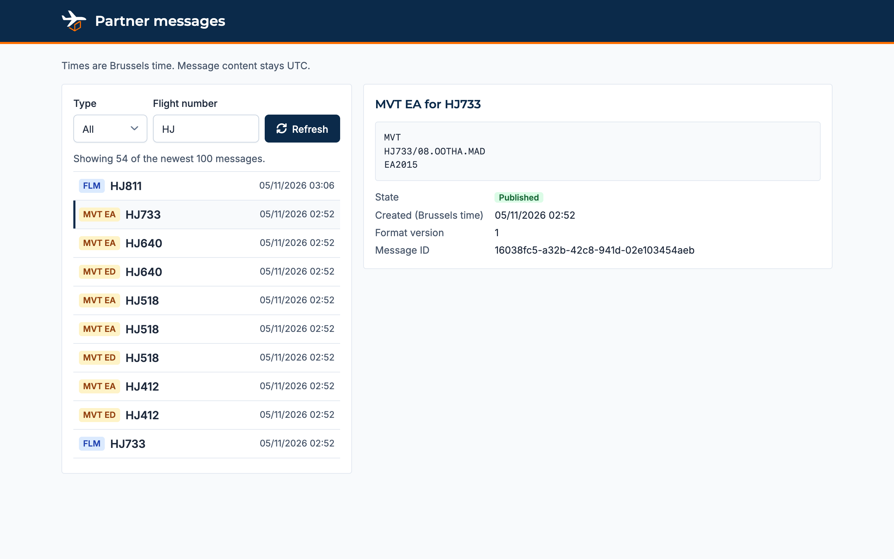
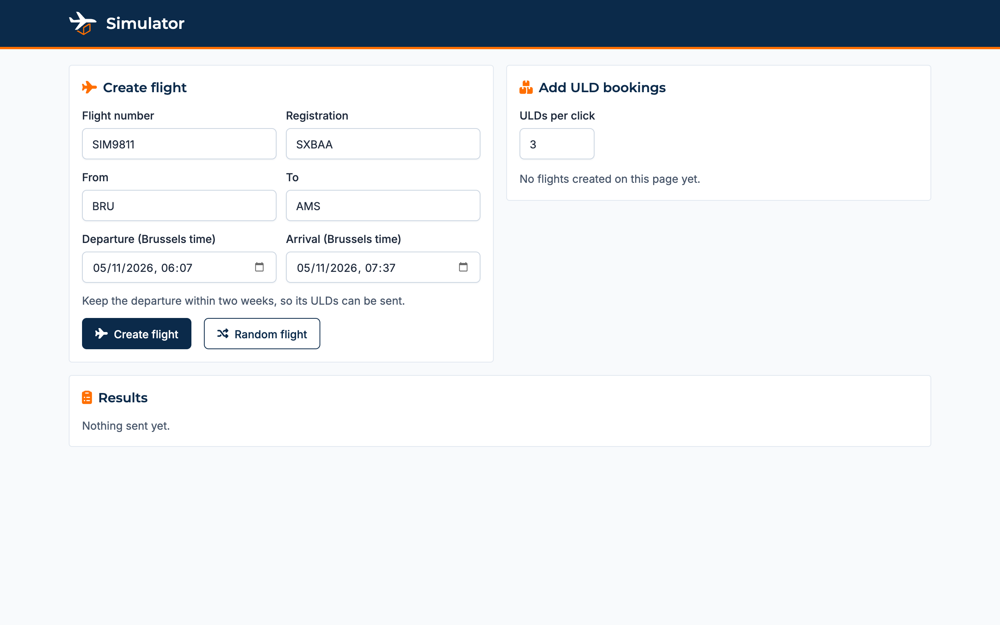

# Air Freight Operations

Stack: Java 22, Spring Boot 4.1.1, Gradle 9.7.1 (multi-project build), PostgreSQL, RabbitMQ, Keycloak.

| Project | Port | Database | Purpose |
| --- | --- | --- | --- |
| `flight/flight-service` and `flight/flight-frontend` | 8080 | `flight` | Flights from SSM, delays, processed CPM as departure condition, actual departure and arrival, flight planner pages |
| `cargo/cargo-service` and `cargo/cargo-frontend` | 8081 | `cargo` | ULD bookings, loading window, positions, load check, finalizing, load planner pages |
| `message-formatter-service` / `partner-communication-service` | 8084 / 8082 | none / `partner_communication` | Formats FLM, MVT ED/EA/AD/AA and CPM / stores and publishes prepared messages to partners |
| `simulator` | 8083 | none | Sends test SSM and ULD messages, local only |

Each service uses the packages `domain`, `application`, `infrastructure` and `api`. The design is in [architecture/analyse.md](architecture/analyse.md).

## Screenshots

| Flights | Timeline |
| --- | --- |
|  |  |

| Flight details | Replan a flight |
| --- | --- |
|  |  |

| Flights to load | Load check |
| --- | --- |
|  |  |

| Finalized cargo plan | Partner messages |
| --- | --- |
|  |  |

| Simulator | Phone |
| --- | --- |
|  |  |

## Run

Requires Docker with Compose. Set up Keycloak first (see [Keycloak](#keycloak)), then:

```sh
docker compose up -d --build --wait
docker compose down
```

Pages: Flight at `http://localhost:8080/`, Cargo at `http://localhost:8081/`, Partner messages at `http://localhost:8082/`. Each service's `/actuator/health` checks its database and RabbitMQ; Cargo's also checks Flight.

Each service creates its tables from `schema.sql` and Hibernate validates them. There is no migration tool, so after a schema change you recreate that service's database (Flight's `actual_departure` and `actual_arrival` columns and the replanning columns of Flight and Cargo are the exception: their `schema.sql` adds them with `ALTER TABLE ... IF NOT EXISTS`, so an existing database keeps its data). Example for Cargo:

```sh
docker compose stop cargo-service
docker compose exec app-postgres psql -U user -d postgres -c 'DROP DATABASE cargo WITH (FORCE)' -c 'CREATE DATABASE cargo'
docker compose up -d --build --wait cargo-service
```

`docker compose down -v` resets everything, including the Keycloak realm.

## Local development

Import the root Gradle project with JDK 22. Start the infrastructure, then run a service from the IDE or with `./gradlew :<project>:bootRun`, for example `./gradlew :flight:flight-service:bootRun`.

```sh
docker compose up -d --wait app-postgres app-rabbitmq keycloak
```

| Infrastructure | Address | User | Password |
| --- | --- | --- | --- |
| PostgreSQL | `localhost:5443` | `user` | `password` |
| RabbitMQ | `localhost:5672`, management `http://localhost:15672` | `user` | `password` |
| Keycloak (dev mode) | `http://localhost:8180` | `admin` | `admin` |
| Keycloak database (MySQL) | `localhost:3307` | `keycloak` | `password` |

These credentials are for development only.

Settings are in each service's `application.properties` and can be overridden with environment variables. Compose reads `.env`; the IDE does not, so set `CARGO_SERVICE_CLIENT_SECRET` in Cargo's run configuration.

The loading window opens 12h before STD and closes 20m before ETD. Change this with `CARGO_LOADINGWINDOW_OPENSBEFORESTD` and `CARGO_LOADINGWINDOW_CLOSESBEFOREETD` (for example `48h`, `30m`) and restart Cargo.

An actual departure or arrival may be at most 5m later than ETD or ETA (the limit itself is accepted). Change this with `FLIGHT_ACTUALTIMES_TOLERANCE` (for example `10m`, `0m`) and restart Flight; a negative value stops the start.

Lateral balance: the heavier side may weigh at most the lighter side plus 10%, compared in kg (1 lb = 0.45359237 kg). Change the tolerance with `CARGO_LOADCHECK_LATERALBALANCETOLERANCE` (for example `0.15`) and restart Cargo.

### Frontends

The pages are TypeScript with Tailwind CSS and `keycloak-js`, built with Vite in `cargo/cargo-frontend` and `flight/flight-frontend`. Building a service also builds its pages into the JAR. Gradle downloads Node, so you do not need to install it.

Times: APIs, databases and messages use UTC. Flight and Cargo display dates and times in `Europe/Brussels`; their day overviews filter on the UTC scheduled departure date. Actual departure and arrival are entered in Brussels time and converted to UTC before submission; nonexistent or ambiguous local times are rejected. Frontend formatting tests cover summer and winter time and dates across midnight, with Cargo also checking both clock changes.

The Keycloak settings `VITE_KEYCLOAK_URL`, `VITE_KEYCLOAK_REALM` and `VITE_KEYCLOAK_CLIENT_ID` are fixed at build time. Rebuild after changing them.

For live reload, keep the backend running and start one of:

```sh
./gradlew :flight:flight-frontend:npm_run_dev   # http://localhost:5173
./gradlew :cargo:cargo-frontend:npm_run_dev     # http://localhost:5174
```

Vite forwards `/api` to the backend. Add the dev URL to the frontend client's redirect URIs in Keycloak first (for Cargo also to its web origins).

### Simulator

Run `./gradlew :simulator:bootRun`. It listens on 127.0.0.1:8083 and is never deployed.

The page at `http://localhost:8083/` creates a test flight and adds ULD bookings to it, one click each. It sends the same requests as the `.http` files, takes Brussels time and sends UTC. Flight and Cargo must be running.

With the `.http` files:

1. Send [simulator/http/ssm.http](simulator/http/ssm.http) and wait until the flight exists.
2. Send [simulator/http/uld.http](simulator/http/uld.http). Use a departure date within two weeks, because a ULD message only carries the day of the month.

A 202 answer only means the message was published. The Cargo log and database show the result.

The simulator also plays the external planning system: it reads `planning.flight-replanned` and answers every replanned flight with a normal SSM for the new flight (message ID `replan-<event ID>`). Start it to let replanned flights get their new flight; until then the event waits in that durable queue. The replanning demo is at the end of `http/local.http`.

### Replanning a flight (out of scope, built anyway)

The course puts replanning outside the system. We still let a flight planner start it, so a flight whose delays pass 12 hours is not stuck: Flight refuses the delay with 409 and the proposed new flight, the planner confirms, Flight marks the old flight `REPLANNED` and publishes `flight.replanned`. The simulator answers with an SSM; the new flight gets the old number plus a letter (`HJ500` → `HJ500A`), the would-be ETD/ETA as its schedule, no delays, and a `replaces` link to the old flight. In the same transaction Flight links both flights and publishes `flight.replaced`; Cargo then moves the bookings and positions to the new flight (old plan `REPLANNED` with `movedTo`, new plan `DRAFT`), and partners get the FLM of the new flight plus a `FLIGHT_REPLANNED` message. `REPLANNED` is final: no delays, no replanning, no CPM.

### Partner messages page

A read-only inbox at `http://localhost:8082/` shows what Partner stored and sent: the newest 100 messages with a type filter and a flight search, and per message the exact content, state and metadata. It is plain files in `partner-communication-service/src/main/resources/static`, so it needs no Node build.

The page and its API have no sign-in, so they are only safe because Compose publishes port 8082 on 127.0.0.1.

## Keycloak

1. Import [infrastructure/keycloak/air-freight-realm.json](infrastructure/keycloak/air-freight-realm.json) in the admin console: Manage realms, Create realm, Browse. It contains the realm `air-freight`, the roles `flight-planner` and `load-planner`, the clients and the audience mappers. It has no users and its secrets are masked.
2. Create one flight planner and one load planner user and give each the matching realm role.
3. Under Clients, Credentials, regenerate the secrets of `flight-service` and `cargo-service`. Put Cargo's secret in `.env` as `CARGO_SERVICE_CLIENT_SECRET`, put both in `http/http-client.private.env.json` (copy it from the `.example` file), then restart Cargo.

The pages sign in with the public clients `flight-frontend` and `cargo-frontend` (authorization code with PKCE). Both planners can read everything. Only a flight planner can change Flight data and only a load planner can change Cargo data. Cargo reads Flight with its own service token. Cargo's pages, health endpoints and `/error` need no token; every other path without its own rule is refused (401 without a token, 403 with one).

## API

Every Flight and Cargo API request needs a bearer token. Times are UTC. In the paths below, `{flight}` stands for `{flightNumber}/{scheduledDepartureDate}/{departureAirportCode}`, for example `HJ221/2026-10-19/BRU`. Example requests are in [http/local.http](http/local.http).

| Service | Method | Path | Role needed |
| --- | --- | --- | --- |
| Flight | GET | `/api/flights?date=2026-10-19` (UTC departure day), `/api/flights/timeline?date=2026-10-19` (Brussels day) | any planner |
| Flight | GET | `/api/flights/{flight}` | any planner |
| Flight | GET | `/api/delay-reasons` | any planner |
| Flight | GET | `/api/airports` | any planner |
| Flight | POST | `/api/flights/{flight}/departure-delays`, `/api/flights/{flight}/arrival-delays` | flight planner |
| Flight | PATCH, DELETE | `/api/flights/{flight}/departure-delays/{delayId}`, `/api/flights/{flight}/arrival-delays/{delayId}` | flight planner |
| Flight | POST | `/api/flights/{flight}/departure` with `{"actualDeparture": "2026-11-10T20:03:00Z"}`, `/api/flights/{flight}/arrival` with `{"actualArrival": ...}` (once; 200 with the flight, `DEPARTED` or `LANDED`) | flight planner |
| Flight | POST | `/api/flights/{flight}/replanning` (the refused delay change: `delayType`, `delayId` or null, `minutes`, `reasonCode`, `description`; 200 with the old flight, now `REPLANNED`, and its `replanning`) | flight planner |
| Cargo | GET | `/api/flights?date=2026-10-19`, add `&includeDeparted=true` for departed flights | any planner |
| Cargo | GET | `/api/cargo-plans/{flight}` | any planner |
| Cargo | GET | `/api/cargo-plans/{flight}/loading-window` | any planner |
| Cargo | GET | `/api/loading-positions` | any planner |
| Cargo | PUT, DELETE | `/api/cargo-plans/{flight}/bookings/{uldCode}/position` | load planner |
| Cargo | GET | `/api/cargo-plans/{flight}/load-check` (all checks, nothing changes) | any planner |
| Cargo | POST | `/api/cargo-plans/{flight}/finalization` (reruns the checks; 200 with `finalizedAt` and the report) | load planner |
| Partner | GET | `/api/partner-messages?limit=100` (newest first, `limit` 1 to 500, default 100; `flightNumber` is read from the payload for display and can be null) | none, local only |

Errors use `ProblemDetail`: 400 for invalid input, 404 for an unknown flight, 409 when a business rule refuses the action (with the reason), 503 when Cargo cannot reach Flight. A delay change that would bring all delays of a flight (departure and arrival together) over 720 minutes gives 409 with `refusal: TOTAL_DELAY_EXCEEDED`, `totalMinutes`, `maxTotalMinutes` and `replanningPossible` (true only for a planned flight that can get a free flight number), plus the proposed `newFlightNumber`, `newScheduledDeparture` and `newScheduledArrival`. The replanning itself refuses with `NOT_PLANNED`, `REPLANNING_NOT_NEEDED` (total within 720), `NO_FREE_FLIGHT_NUMBER` (every letter up to Z taken) or `SCHEDULE_NOT_EXPRESSIBLE` (new flight longer than 24 h). A finalize that fails a hard check gives 409 with `refusal: HARD_CHECKS_FAILED` and the same `report` as the load check. Check and finalize also refuse with the loading refusals (`PLAN_FINALIZED`, `WINDOW_CLOSED`, ...). An actual time is refused with 409 and `refusal` `NOT_PLANNED`, `NOT_DEPARTED`, `CPM_NOT_PROCESSED` (finalize the load first, then try again), `IN_THE_FUTURE`, `NOT_AFTER_DEPARTURE` or `TOO_LATE` (with `latestAllowed`: add a delay first); a missing time is 400. The page enters the time in Brussels time and sends a UTC instant with whole minutes.

Cargo keeps its own copy of Flight's flights, filled by Flight's events (see [Messages](#messages)), and asks Flight over HTTP only for a flight that is not in the copy yet. So Cargo's pages keep working while Flight is down, except for a flight Cargo has never seen. Cargo's `/actuator/health` still reports `DOWN` then, because `FlightApiHealthIndicator` checks Flight, so Docker marks `cargo-service` unhealthy. A flight created before Cargo's queues first existed is missing from Cargo's day overview until someone opens it by its key (cargo plan or ULD booking). Start Cargo at least once before sending SSMs, or reset with `docker compose down -v`. The copy's status follows `flight.departed` and `flight.landed` and only moves forward.

## Messages

| Queue or exchange | Routing keys | Content |
| --- | --- | --- |
| `flight.ssm` | | SSM from the simulator |
| `cargo.uld` | | ULD bookings, provisional format below (Q01) |
| `flight.events` | `flight.created`, `flight.estimates-changed`, `flight.departed`, `flight.landed` | From Flight to Formatter and Cargo, sent through Flight's outbox; Formatter hands batches to Partner using `formatter.events` / `partner-messages.prepared` / `partner.messages-prepared`. Formatter reads them on `partner.flight-created`, `partner.flight-estimates-changed`, `formatter.flight-departed` and `formatter.flight-landed` (the two older queues kept their `partner.` name, newer Formatter queues use `formatter.`); Cargo on `cargo.flight-created`, `cargo.flight-estimates-changed`, `cargo.flight-departed` and `cargo.flight-landed`. Flight publishes with `mandatory=true`, so a consumer must have declared its queue once before the first event or that event stays pending in Flight's outbox |
| `flight.events` | `flight.replanned` | The old flight ended and the planning system should announce the new one (old key, airports, registration, STD/STA, `newFlightNumber`, `newScheduledDepartureDate`, `newScheduledDeparture`, `newScheduledArrival`). Simulator on `planning.flight-replanned` (declared by Flight and by the simulator with the same arguments, dead letters to `flight.dlx`); Cargo on `cargo.flight-replanned` (copy status) |
| `flight.events` | `flight.replaced` | The new flight exists, published in the SSM transaction that created it (old key, `newFlightNumber`, `newScheduledDepartureDate`, `newDepartureAirportCode`, `newScheduledDeparture`, `newScheduledArrival`). Cargo on `cargo.flight-replaced` moves the cargo; Formatter on `formatter.flight-replaced` makes the `FLIGHT_REPLANNED` partner message |
| `cargo.events` | `cargo.load-finalized` | From Cargo's outbox after finalizing, contract below. Flight (`flight.cargo-load-finalized`) records it as departure condition; Formatter (`formatter.cargo-load-finalized`) makes the partner CPM |
| `partner.messages` | `flm`, `mvt.ed`, `mvt.ea`, `mvt.ad`, `mvt.aa`, `cpm`, `flight.replanned` | To partners: FLM, CPM and FLIGHT_REPLANNED (`oldFlight`, `newFlight`, `newScheduledDeparture`, `newScheduledArrival`; our own designed message, the course defines none) as JSON with `messageId`, `createdAt`, `formatVersion`, `type` and `payload`, MVT as three lines of text with UTC times (`MVT`, `HJ221/09.SXBAA.BRU`, `AD2003`) and the metadata in the AMQP headers |

ULD booking:

```json
{
  "messageId": "uld-0001",
  "version": 1,
  "flightNumber": "HJ221",
  "scheduledDepartureDay": 19,
  "departureAirportCode": "BRU",
  "uldCode": "AKE12345KL",
  "weight": { "value": 1250.5, "unit": "KG" },
  "destination": "AMS"
}
```

Load finalized, version 1 (only positioned ULDs, weight in the booked unit, the list may be empty; a field change needs version 2):

```json
{
  "messageId": "81a28ad9-6b2e-4064-b231-02dd702a8198",
  "version": 1,
  "occurredOn": "2026-11-04T15:07:45.862Z",
  "flightNumber": "HJ901",
  "scheduledDepartureDate": "2026-11-04",
  "departureAirportCode": "BRU",
  "ulds": [
    { "uldCode": "AKE90001HJ", "position": "CL", "weight": { "value": 1000, "unit": "KG" }, "destinationAirportCode": "AMS" }
  ]
}
```

Flight departed, version 1 (`flight.landed` has the same fields with `actualArrival` instead of `actualDeparture`; `occurredOn` is the registration time, the actual time is what the planner entered):

```json
{
  "messageId": "3c0f4c0a-8f0e-4bd9-9d6d-5a1c2b3d4e5f",
  "version": 1,
  "occurredOn": "2026-11-10T20:04:11Z",
  "flightNumber": "HJ500",
  "scheduledDepartureDate": "2026-11-10",
  "departureAirportCode": "BRU",
  "arrivalAirportCode": "AMS",
  "aircraftRegistration": "SXBAA",
  "actualDeparture": "2026-11-10T20:03:00Z"
}
```

Every message has a stable ID. Cargo processes a ULD message only once: it remembers the ID in `processed_messages`. Flight's events are not deduplicated by ID in Cargo but are idempotent: Cargo only changes a flight's schedule and estimates for a newer change time (`last_change_at`), only moves its status forward (`advanceStatus`), and a moved cargo plan is marked `REPLANNED`, so the same event twice changes nothing. A redelivered `flight.replanned` gives the simulator's SSM the same ID, and Flight skips an existing flight (no second flight, FLM or `flight.replaced`). Partner stores one message per source event and type, so a redelivered `flight.departed` sends one AD. Cargo stores invalid ULD and flight messages in its `rejected_messages` table, also a booking for a finalized cargo plan ("Cargo plan of flight ... is finalized, no ULD can be added"). Flight, Formatter and Partner send invalid messages to a dead-letter queue (`flight.dlq`, Formatter's `partner.dlq`, Sender's `partner.sender.dlq`) and requeue temporary database failures and Formatter publication failures on the original queue after the configured short retries. Flight first stores the ID, content and reason in its own `rejected_messages` table and logs them, so a rejected SSM is found by its ID: `SELECT * FROM rejected_messages WHERE message_id = '<id>';`.

## Checks

```sh
npm ci                     # installs the Husky git hooks, needs Node.js
./gradlew spotlessApply    # formats the Java code
./gradlew check assemble   # format check, lint, tests and JARs
```

Tools: Spotless, Checkstyle, JUnit, ArchUnit, Testcontainers, JaCoCo and Vitest (Flight and Cargo pages). Coverage reports are in `<project>/build/reports/jacoco/test/`. Database tests (`*IT`) need Docker and are skipped without it, as in GitLab CI.
