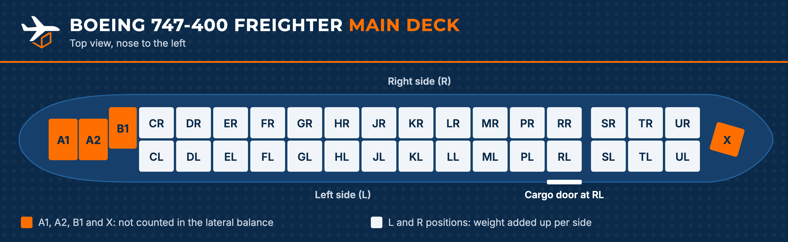
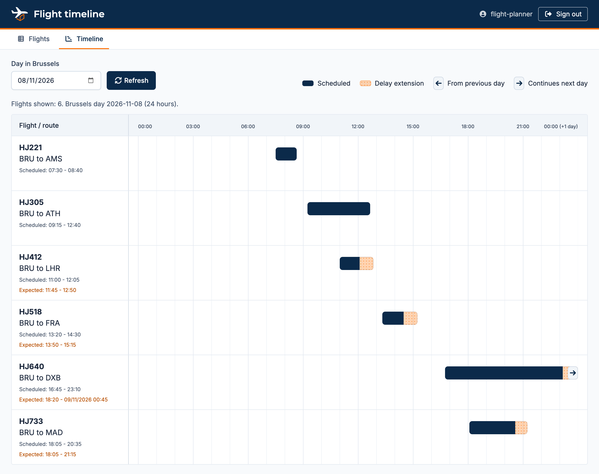
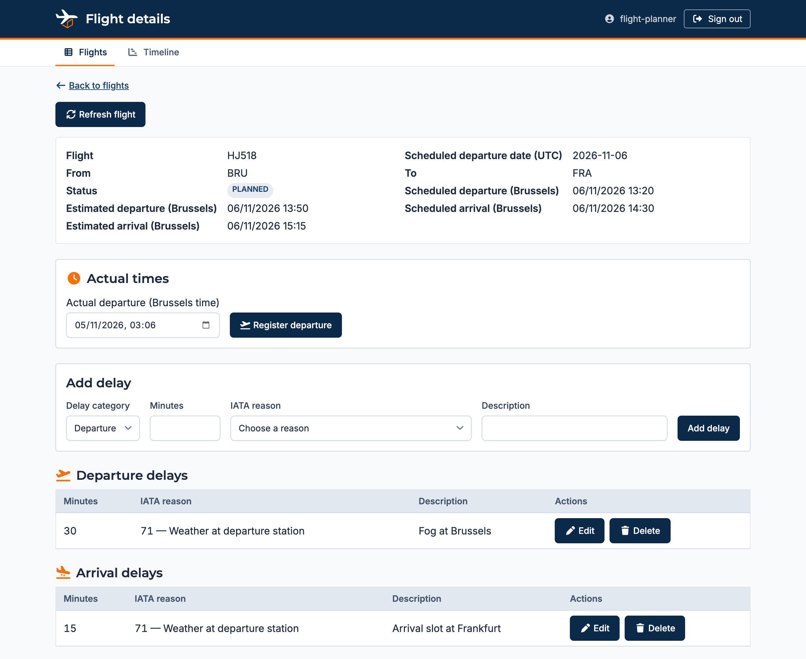
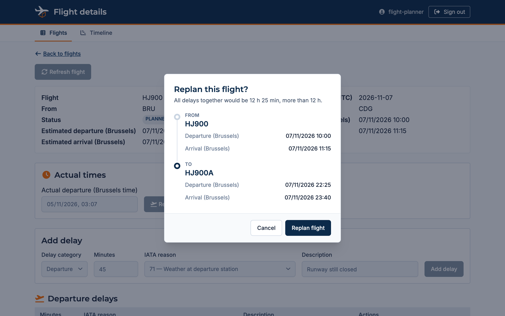
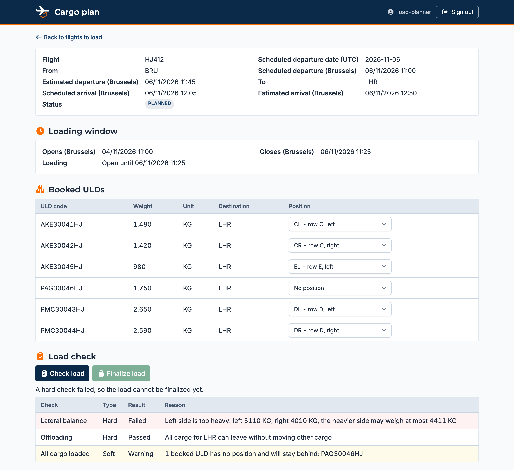
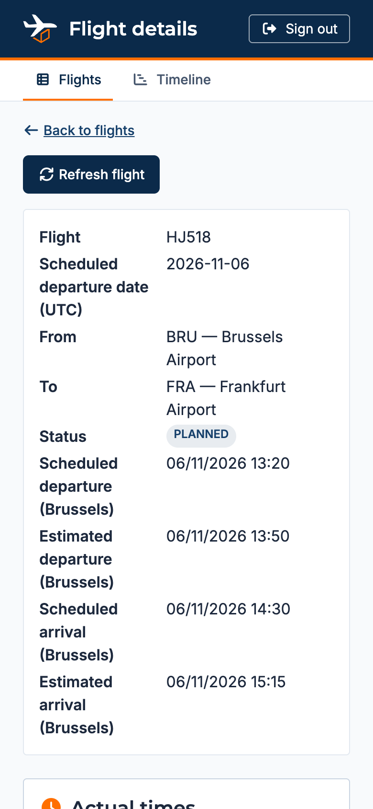

# Air Freight Operations


Stack: Java 22, Spring Boot 4.1.1, Gradle 9.7.1 (multi-project build), PostgreSQL, RabbitMQ, Keycloak.

| Project | Port | Database | Purpose |
| --- | --- | --- | --- |
| `flight/flight-service`, `flight/flight-frontend` | 8080 | `flight` | Flights, delays, actual times, flight planner pages |
| `cargo/cargo-service`, `cargo/cargo-frontend` | 8081 | `cargo` | ULD bookings, positions, load checks, finalizing, load planner pages |
| `partner-communication-service` | 8082 | `partner_communication` | Stores and publishes partner messages, read-only inbox page |
| `message-formatter-service` | 8084 | none | Formats FLM, MVT and CPM |
| `simulator` | 8083 | none | Test page and SSM and ULD messages, local only |

## Main deck



## Screenshots

| Flights | Timeline |
| --- | --- |
|  |  |

| Flight details | Replan a flight |
| --- | --- |
|  |  |

| Flights to load | Load check |
| --- | --- |
|  |  |

| Finalized cargo plan | Partner messages |
| --- | --- |
|  |  |

| Simulator | Phone |
| --- | --- |
|  |  |

## Run

Requires Docker with Compose. The first time, create `.env`, start Keycloak and follow [Keycloak](#keycloak):

```sh
cp .env.example .env
docker compose up -d --wait keycloak
```

Start and stop everything:

```sh
docker compose up -d --build --wait
docker compose down
```

Pages: Flight `http://localhost:8080/`, Cargo `http://localhost:8081/`, Partner messages `http://localhost:8082/`. The Partner page and API have no sign-in, so Compose publishes that port on 127.0.0.1 only. Each service has `/actuator/health`. Cargo's also checks Flight, so Docker marks Cargo unhealthy while Flight is down, even though its pages keep working for flights in its copy.

Each service creates its tables from `schema.sql` and Hibernate validates them. There is no migration tool, so a schema change can need a fresh database. `docker compose down -v` resets everything, including the Keycloak realm. For one service:

```sh
docker compose stop cargo-service
docker compose exec app-postgres psql -U user -d postgres -c 'DROP DATABASE cargo WITH (FORCE)' -c 'CREATE DATABASE cargo'
docker compose up -d --build --wait cargo-service
```

Start Cargo at least once before sending SSMs: Flight publishes with `mandatory=true`, so an event stays in its outbox until every consumer has declared its queue.

## Local development

Import the root Gradle project with JDK 22, start the infrastructure, then run a service from the IDE or with `./gradlew :<project>:bootRun`.

```sh
docker compose up -d --wait app-postgres app-rabbitmq keycloak
```

| Infrastructure | Address | User | Password |
| --- | --- | --- | --- |
| PostgreSQL | `localhost:5443` | `user` | `password` |
| RabbitMQ | `localhost:5672`, UI `http://localhost:15672` | `user` | `password` |
| Keycloak | `http://localhost:8180` | `admin` | `admin` |
| Keycloak database (MySQL) | `localhost:3307` | `keycloak` | `password` |

These credentials are for development only.

### Settings

Every setting is in the service's `application.properties`. Override it with the environment variable and restart; no source change is needed. Compose sets the same variables with its own service names and reads `.env`. The IDE does not read `.env`, so set `CARGO_SERVICE_CLIENT_SECRET` in Cargo's run configuration.

| Setting | Services | Environment variable | Default |
| --- | --- | --- | --- |
| Own port | all | `SERVER_PORT` | see the first table |
| PostgreSQL | Flight, Cargo, Partner | `SPRING_DATASOURCE_URL`, `_USERNAME`, `_PASSWORD` | `jdbc:postgresql://localhost:5443/<database>` |
| RabbitMQ | all | `SPRING_RABBITMQ_HOST`, `_PORT`, `_USERNAME`, `_PASSWORD` | `localhost`, `5672` |
| Token check | Flight, Cargo | `SPRING_SECURITY_OAUTH2_RESOURCESERVER_JWT_ISSUER_URI`, `_JWK_SET_URI` | `http://localhost:8180/realms/air-freight` |
| Token for Flight | Cargo | `SPRING_SECURITY_OAUTH2_CLIENT_PROVIDER_FLIGHT_TOKENURI`, `CARGO_SERVICE_CLIENT_SECRET` | same realm, the secret has no default |
| Flight API | Cargo | `FLIGHT_API_URL` | `http://localhost:8080` |
| Page links | Simulator | `SIMULATOR_FLIGHT_URL`, `SIMULATOR_CARGO_URL` | `http://localhost:8080`, `:8081` |
| Loading window | Cargo | `CARGO_LOADINGWINDOW_OPENSBEFORESTD`, `CARGO_LOADINGWINDOW_CLOSESBEFOREETD` | `12h`, `20m` |
| Lateral balance tolerance | Cargo | `CARGO_LOADCHECK_LATERALBALANCETOLERANCE` | `0.10` |
| Actual time tolerance | Flight | `FLIGHT_ACTUALTIMES_TOLERANCE` | `5m` |
| Retention after the scheduled departure date | Flight | `FLIGHT_RETENTION_PERIOD` | `7d` |
| Cleanup interval | Flight | `FLIGHT_RETENTION_CLEANUPINTERVAL` | `1h` |

To move Keycloak in Compose, set `VITE_KEYCLOAK_URL` and `VITE_KEYCLOAK_REALM` in `.env`, change the published port if needed and rebuild. When a page address changes, add it to the redirect URIs of its client in Keycloak.

Queue and exchange names are constants, because they are the message contract between the services.

### Frontends

Flight and Cargo pages are TypeScript with Tailwind CSS and `keycloak-js`, built with Vite into the service's JAR. Gradle downloads Node. `VITE_KEYCLOAK_URL`, `VITE_KEYCLOAK_REALM` and `VITE_KEYCLOAK_CLIENT_ID` are read at build time, so rebuild after changing them; in `.env` the client IDs are `FLIGHT_FRONTEND_CLIENT_ID` and `CARGO_FRONTEND_CLIENT_ID`.

For live reload, keep the backend running and start one of these. Add the dev URL to the client's redirect URIs in Keycloak first (for Cargo also to its web origins).

```sh
./gradlew :flight:flight-frontend:npm_run_dev   # http://localhost:5173
./gradlew :cargo:cargo-frontend:npm_run_dev     # http://localhost:5174
```

Vite forwards `/api` to `FLIGHT_API_URL` or `CARGO_API_URL`, by default the local port.

### Simulator

Run `./gradlew :simulator:bootRun`. It listens on 127.0.0.1:8083 and is never deployed. Its page at `http://localhost:8083/` creates a test flight and adds ULD bookings; Flight and Cargo must be running. It also answers replanned flights with a new SSM, so start it to let them get their new flight.

The same requests are in [simulator/http/ssm.http](simulator/http/ssm.http) and [simulator/http/uld.http](simulator/http/uld.http). Send the SSM first and use a departure date within two weeks, because a ULD message only carries the day of the month. A 202 answer only means the message was published.

## Keycloak

1. In the admin console, import [infrastructure/keycloak/air-freight-realm.json](infrastructure/keycloak/air-freight-realm.json): Manage realms, Create realm, Browse. It has the realm, roles, clients and audience mappers, but no users, and its secrets are masked.
2. Create a flight planner and a load planner user and give each the matching realm role (`flight-planner`, `load-planner`).
3. Under Clients, Credentials, regenerate the secrets of `flight-service` and `cargo-service`. Put Cargo's in `.env` as `CARGO_SERVICE_CLIENT_SECRET`, put both in `http/http-client.private.env.json` (copy the `.example` file), then restart Cargo.

Both planners can read everything. Only a flight planner changes Flight data and only a load planner changes Cargo data.

## API

Flight and Cargo requests need a bearer token. Times are UTC. `{flight}` stands for `{flightNumber}/{scheduledDepartureDate}/{departureAirportCode}`, for example `HJ221/2026-10-19/BRU`. Examples are in [http/local.http](http/local.http).

| Service | Method | Path | Role |
| --- | --- | --- | --- |
| Flight | GET | `/api/flights?date=`, `/api/flights/timeline?date=`, `/api/flights/{flight}` | any planner |
| Flight | GET | `/api/delay-reasons`, `/api/airports` | any planner |
| Flight | POST | `/api/flights/{flight}/departure-delays`, `.../arrival-delays` | flight planner |
| Flight | PATCH, DELETE | `/api/flights/{flight}/departure-delays/{delayId}`, `.../arrival-delays/{delayId}` | flight planner |
| Flight | POST | `/api/flights/{flight}/departure`, `.../arrival` | flight planner |
| Flight | POST | `/api/flights/{flight}/replanning` | flight planner |
| Cargo | GET | `/api/flights?date=`, add `&includeDeparted=true` for departed flights | any planner |
| Cargo | GET | `/api/cargo-plans/{flight}`, `.../loading-window`, `.../load-check`, `/api/loading-positions` | any planner |
| Cargo | PUT, DELETE | `/api/cargo-plans/{flight}/bookings/{uldCode}/position` | load planner |
| Cargo | POST | `/api/cargo-plans/{flight}/finalization` | load planner |
| Partner | GET | `/api/partner-messages?limit=100` (1 to 500) | none, local only |

Errors use `ProblemDetail`: 400 for invalid input, 401 or 403 for sign-in and role, 404 for an unknown flight, 503 when Cargo cannot reach Flight, and 409 with a `refusal` code when a business rule says no:

| Action | `refusal` |
| --- | --- |
| Delay change | `TOTAL_DELAY_EXCEEDED`, with `replanningPossible` and the proposed new flight |
| Replanning | `NOT_PLANNED`, `REPLANNING_NOT_NEEDED`, `NO_FREE_FLIGHT_NUMBER`, `SCHEDULE_NOT_EXPRESSIBLE` |
| Actual time | `NOT_PLANNED`, `NOT_DEPARTED`, `CPM_NOT_PROCESSED`, `IN_THE_FUTURE`, `NOT_AFTER_DEPARTURE`, `TOO_LATE` (with `latestAllowed`) |
| Position, check, finalize | `PLAN_FINALIZED`, `FLIGHT_NOT_PLANNED`, `WINDOW_NOT_OPEN_YET`, `WINDOW_CLOSED` |
| Finalize | `HARD_CHECKS_FAILED`, with the check `report` |

## Messages

| Exchange or queue | Routing key | From, to | Content |
| --- | --- | --- | --- |
| `flight.ssm` | | Simulator, Flight | SSM |
| `cargo.uld` | | Simulator, Cargo | ULD booking |
| `flight.events` | `flight.created`, `flight.estimates-changed`, `flight.departed`, `flight.landed` | Flight, Formatter and Cargo | Flight facts |
| `flight.events` | `flight.replanned` | Flight, Simulator and Cargo | Old flight ended, proposed new flight |
| `flight.events` | `flight.replaced` | Flight, Formatter and Cargo | The new flight exists |
| `flight.events` | `flight.removed` | Flight, Cargo | The flight passed its retention, Cargo removes its data |
| `cargo.events` | `cargo.load-finalized` | Cargo, Flight and Formatter | Finalized load |
| `formatter.events` | `partner-messages.prepared` | Formatter, Partner | Prepared messages |
| `partner.messages` | `flm`, `mvt.ed`, `mvt.ea`, `mvt.ad`, `mvt.aa`, `cpm`, `flight.replanned` | Partner, partners | See below |

To partners, FLM, CPM and FLIGHT_REPLANNED (our own message) are JSON with `messageId`, `createdAt`, `formatVersion`, `type` and `payload`. MVT is three lines of text with UTC times (`MVT`, `HJ221/09.SXBAA.BRU`, `AD2003`) and the metadata in the AMQP headers.

ULD booking (our own format):

```json
{
  "messageId": "uld-0001",
  "version": 1,
  "flightNumber": "HJ221",
  "scheduledDepartureDay": 19,
  "departureAirportCode": "BRU",
  "uldCode": "AKE12345KL",
  "weight": { "value": 1250.5, "unit": "KG" },
  "destination": "AMS"
}
```

`cargo.load-finalized`, version 1 (only positioned ULDs, weight as booked, the list may be empty, a field change needs version 2):

```json
{
  "messageId": "81a28ad9-6b2e-4064-b231-02dd702a8198",
  "version": 1,
  "occurredOn": "2026-11-04T15:07:45.862Z",
  "flightNumber": "HJ901",
  "scheduledDepartureDate": "2026-11-04",
  "departureAirportCode": "BRU",
  "ulds": [
    { "uldCode": "AKE90001HJ", "position": "CL", "weight": { "value": 1000, "unit": "KG" }, "destinationAirportCode": "AMS" }
  ]
}
```

Rejected messages: Cargo and Flight store the ID, content and reason in their `rejected_messages` table, so a rejected SSM is found with `SELECT * FROM rejected_messages WHERE message_id = '<id>';`. Flight then sends it to `flight.dlq`; Formatter and Partner use `partner.dlq` and `partner.sender.dlq`.

## Checks

```sh
npm ci                     # installs the Husky git hooks, needs Node.js
./gradlew spotlessApply    # formats the Java code
./gradlew check assemble   # format check, lint, tests and JARs
```

Tools: Spotless, Checkstyle, JUnit, ArchUnit, Testcontainers, JaCoCo and Vitest. Coverage reports are in `<project>/build/reports/jacoco/test/`. Tests select the `test` profile together with `h2` or `postgres`. PostgreSQL tests in Flight and Cargo require Docker; GitLab provides Docker-in-Docker for those jobs and needs a runner that supports privileged containers. These tests fail if Docker is unavailable. H2 tests do not need Docker.
