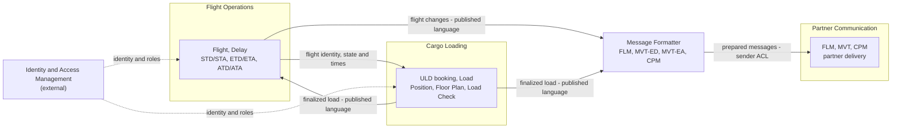
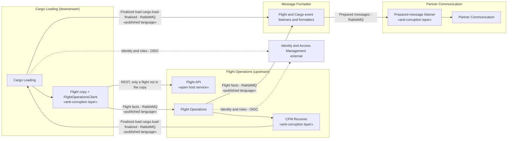
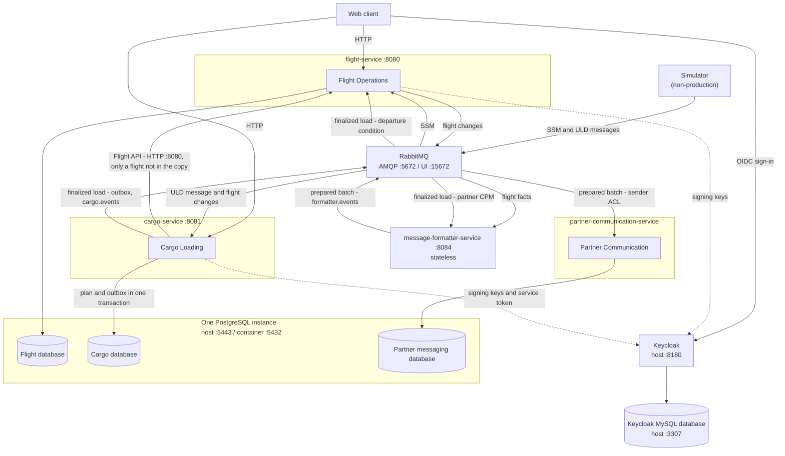
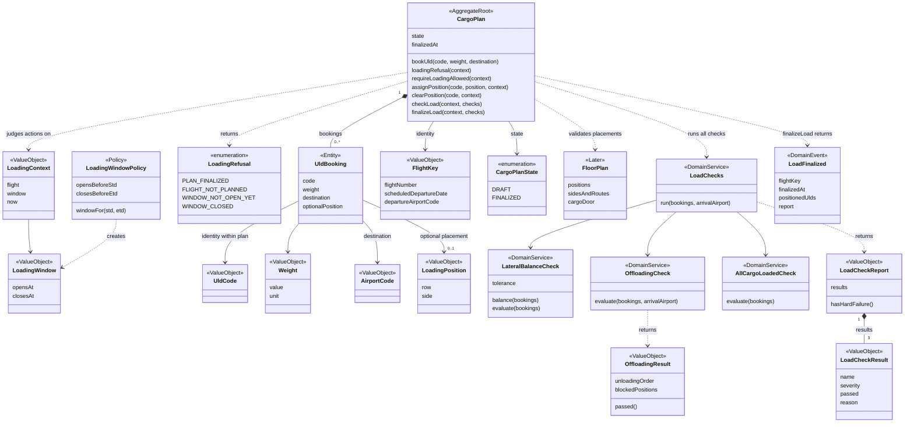
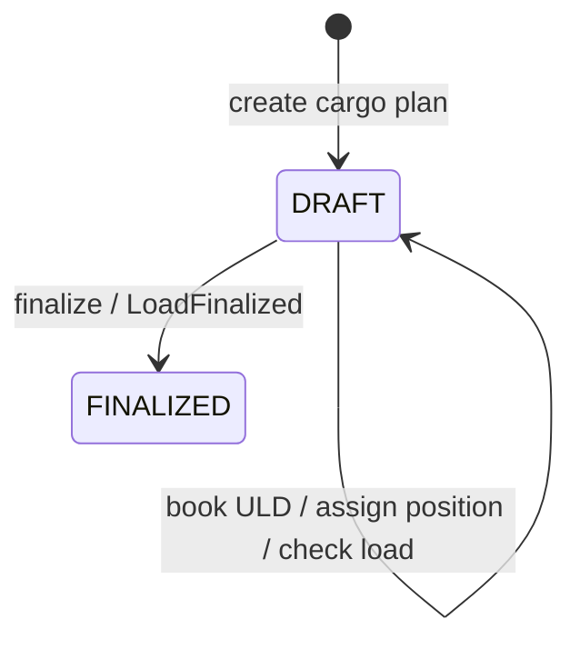
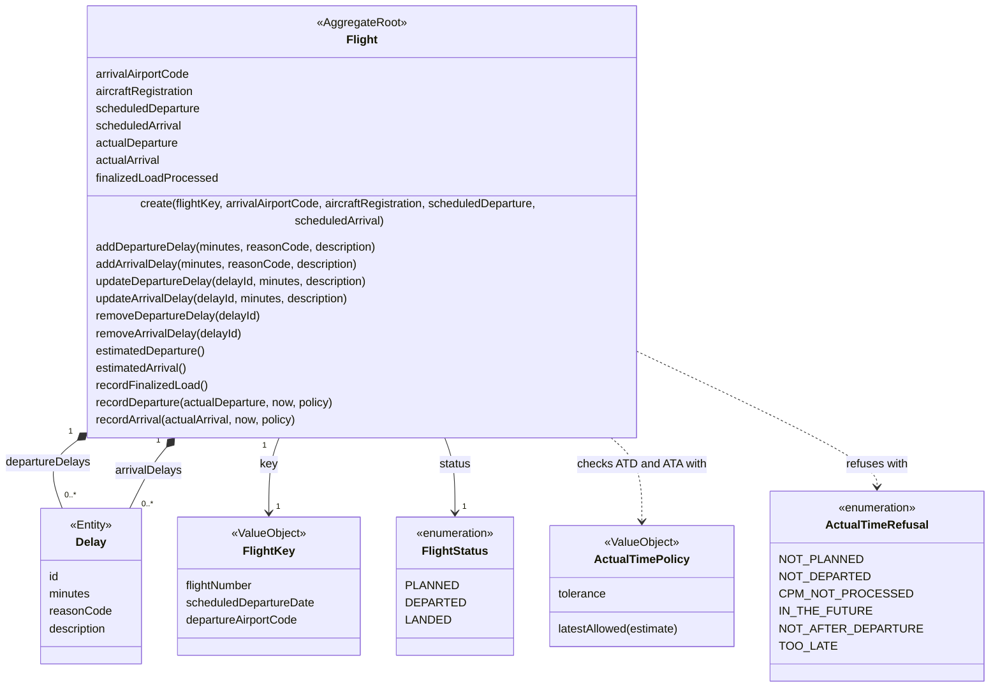
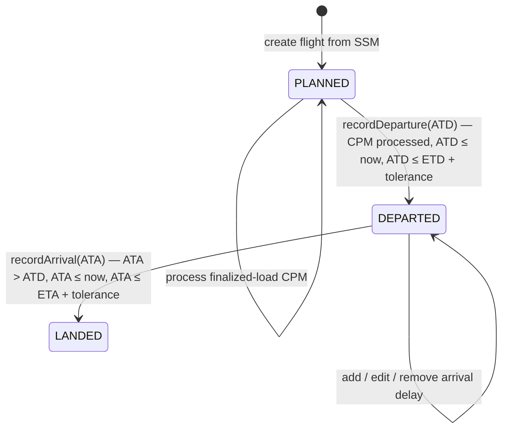
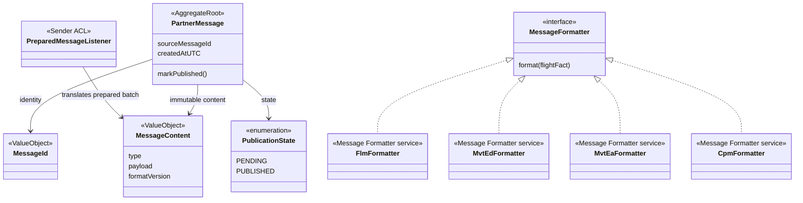
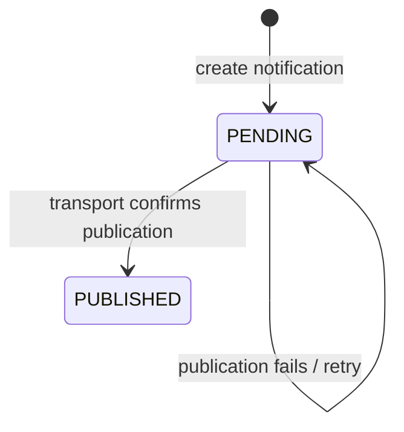

# Air Freight Operations

An airline carries cargo between airports on a fixed flight schedule. Flight planners record delays, their causes, and actual departure and arrival times. Load planners assign booked containers and pallets (ULDs) to aircraft positions, check the load, and finalize it.

Flight schedules and cargo bookings arrive from existing data feeds. The system keeps flight and load information current and creates standard IATA messages for other parties at the appropriate moments, even before any recipients are connected.

## 1. Subdomains

| Subdomain | Type | Rationale |
| --- | --- | --- |
| Flight Planning | Supporting | It keeps flight times and delays reliable so operations can respond. |
| Freight Loading | Core | Planning, checking and finalising the cargo load is central to this air-freight system. |
| Partner Messaging | Supporting | It creates the required flight and load messages for external parties when relevant events occur. |
| Identity and Access Management (IAM)          | Generic | Signing users in is a common problem handled by Keycloak; each operational context still enforces its own action rules. |

## 2. Bounded contexts



## 3. Ubiquitous language

| Term | Flight Operations | Cargo Loading | Message Formatter / Partner Communication |
| --- | --- | --- | --- |
| Flight | Aggregate owning times, status and delays for one dated flight | Flight information used for bookings and load planning | Flight identity and facts used to prepare messages |
| FlightKey | Flight number, UTC scheduled departure date and departure airport code | Identifies the flight of a CargoPlan | Identifies the flight described by a message |
| Airport | Reference with IATA code and display name | Flight arrival and ULD destination codes used to check offloading | Airport code included in messages |
| STD / STA | Immutable scheduled departure / arrival times | STD anchors the loading-period start | Scheduled times included in FLM |
| ETD / ETA | Estimated departure / arrival times calculated from delays | ETD determines the loading-period end | Estimated times included in MVT-ED / MVT-EA |
| ATD / ATA | Recorded actual departure / arrival times | — | Actual times included in MVT-AD / MVT-AA |
| ULD | — | Unit Load Device (container or pallet) booked on a flight, with code, weight and destination; placement is optional | Positioned ULD details included in CPM |
| Weight | — | Value and unit used for cargo calculations | ULD weight and unit included in CPM |
| Loading position | — | Named place on the aircraft deck | ULD position included in CPM |
| Loading window | — | Period from STD - 12 hours to current ETD - 20 minutes in which a planned, unfinalized load may change; recomputed for every action | — |
| Finalized load | Processed CPM confirms the cargo prerequisite for departure | Checked, frozen load | Load snapshot carried in CPM |
| CPM | Received load message whose processing satisfies the cargo prerequisite for departure | Containers / Pallets Message describing the finalized load | Copy forwarded to partners |

## 4. Context map



| Relationship |Pattern | Why |
| --- | --- | --- |
| Flight Operations -> Cargo Loading | Published Language (flight events) and Open Host Service for one unknown flight; Cargo anti-corruption layer | Cargo Loading keeps its own copy of the flights it needs, filled by `flight.created`, `flight.estimates-changed`, `flight.departed` and `flight.landed`, so it keeps working while Flight Operations is down. Its health endpoint still reports `DOWN` then, because `FlightApiHealthIndicator` checks Flight. It asks the flight-information API only for a flight that is not in the copy yet, for example when a ULD booking arrives before `flight.created`. Both paths are translated into Cargo's own model. |
| Cargo Loading -> Flight Operations | Published Language; Flight anti-corruption layer | Cargo Loading publishes the finalized load (`cargo.load-finalized`); Flight's `CpmReceiver` translates it into its departure prerequisite. |
| Flight Operations / Cargo Loading -> Message Formatter | Published Language | Formatter consumes Flight facts for FLM/MVT and Cargo's finalized load for the partner CPM. Cargo never formats the partner CPM. |
| Message Formatter -> Partner Communication | Sender anti-corruption layer | Sender translates prepared batches into its own message model, persists them and publishes them. |

## 5. Deployment



- One PostgreSQL instance hosts three databases: one for Flight Operations, one for Cargo Loading and one for Partner Communication.
- Flight and Cargo each have an `outbox_messages` table. An event is written there in the same transaction as the change and sent after the commit with publisher confirms; a scheduled job resends what is still pending with the same message ID.
- Each service accesses only its own database. Services share information through APIs or RabbitMQ messages.
- Keycloak keeps its realm, clients and users in its own MySQL database, as in the course example.

## 6. Tactical design: Cargo Loading



| Building block | Elements |
| --- | --- |
| Aggregate root | `CargoPlan` (owns bookings) |
| Entity | `UldBooking` |
| Value objects | `FlightKey`, `UldCode`, `Weight`, `AirportCode`, `LoadingPosition`, `LoadingWindow`, `LoadingContext`, `OffloadingResult`, `LateralBalance`, `LoadCheckResult`, `LoadCheckReport` |
| Policy | `LoadingWindowPolicy` (configurable offsets); lateral balance tolerance (configurable) |
| Domain checks | `LoadChecks` runs `LateralBalanceCheck`, `OffloadingCheck` and `AllCargoLoadedCheck` (domain services) |
| Domain event | `LoadFinalized` |
| Repository | `CargoPlanRepository` |
| Actors | Load planner |

Invariants on `CargoPlan`:

1. Unique ULD code per flight; one ULD per valid position, one position per ULD.
2. Booking only while planned. Placement, checking and finalization require a load planner, a planned flight, an open loading period and an unfinalized plan. `requireLoadingAllowed(context)` enforces the last three and is the first call of every such method; the load-planner role is checked before, by Spring Security (section 9).
3. Finalization reruns all checks; hard failures block it, soft failures warn.
4. Finalized load cannot change.

Every change to a cargo plan (booking, position, finalization) raises the version of its `cargo_plans` row, and Hibernate checks that version at commit (optimistic locking). Of two overlapping changes the second is rolled back and the API answers 409; a unique constraint on (flight, position) also guards invariant 1 in the database. A ULD with a position moves to a free position in one step; swapping two ULDs takes two steps (team reading of Q16).

`LoadingPosition` is an enum of the 34 main-deck positions of the Boeing 747-400 freighter with row and side; with one aircraft type it is the floor plan's position list, and `OffloadingCheck` derives the routes from it. A second aircraft type would introduce a `FloorPlan` per type.

Marked *later* in the diagram: `FloorPlan` only comes with a second aircraft type. The three checks have different inputs, so there is no common `LoadCheck` interface; `LoadChecks` calls them in a fixed order and builds one report.

Loading period: **STD - 12 hours → current ETD - 20 minutes**

- Both offsets are settings (`cargo.loading-window.*`); `LoadingWindowPolicy` computes the window from STD and ETD only, so arrival times cannot move it.
- The window is half open: open at the opening instant, closed at the closing instant (team reading of Q06).
- It is never stored. The application service builds a `LoadingContext` per action from Flight's current data, the policy and an injected `Clock`, so a departure delay moves the end at the next action.
- The finalized state is checked first: a later delay never reopens a finalized plan.

### Load checks

| Check | Type | Rule |
| --- | --- | --- |
| Lateral balance | Hard | Heavier side ≤ 110% of lighter side, using a common weight unit; exclude A1, A2, B1 and X. Tolerance is configurable. |
| Offloading | Hard | Destination cargo must reach the door at RL without moving other-destination cargo, following the floor plan's routes and maneuvering rules. |
| Not all cargo loaded | Soft | Warn about bookings without a position. |

- All checks run, also after an earlier one failed; the report keeps the order of the table. Every result has a name, `HARD` or `SOFT`, passed or not, and a reason (also when it passed). Checking changes nothing.
- Hard checks inspect positioned cargo only.
- `CargoPlan.checkLoad` calls `requireLoadingAllowed` first, so a check is refused outside the window and after finalizing (team reading of Q17: Check Load is a loading action).

Lateral balance (#22):

- Left is the sum of the L positions, right of the R positions; A1, A2, B1 and X count for neither side.
- Weights are compared in kg, the common unit we chose (the course names none). LB is converted with the exact international factor 0.45359237 (the course gives no factor, Q15). The report shows both totals in kg.
- `heavier <= lighter × (1 + tolerance)` with exact decimals and no rounding first: 1000/1100 passes, 1000/1101 fails. The report shows the maximum for the heavier side.
- From the formula and not a course case: an empty load passes, cargo on only one side fails (0 against something). So one single ULD on CL blocks finalizing; on A1, A2, B1 or X it does not.
- Tolerance `cargo.load-check.lateral-balance-tolerance`, default `0.10`; a missing or negative value stops the start-up. Changing it needs a restart, not a new release (Q21 stays open).

All cargo loaded (#25): soft; names every booked ULD without a position (sorted), which stays behind. It never blocks finalizing.

Offloading (#23, #24):

- `OffloadingCheck` is a domain service in `domain.offloading`, alongside its result and tests. `LoadChecks` calls it for the report (#21) and for finalizing (#26). It calls no guard; `CargoPlan.checkLoad` calls `requireLoadingAllowed` first.
- Routes follow the order of `LoadingPosition`. A paired position walks along its own side to row R: toward the tail in front of row R, toward the nose behind it. Left cargo leaves through RL; right cargo goes to RR and crosses to RL. A route never switches sides.
- The check simulates unloading on its own copy of the positions. In passes from nose to tail it removes every ULD for the arrival airport whose route is empty at that moment, until a pass removes nothing. Cargo for other airports never moves. The removal order is a legal unloading order (published example 2: RR, then UR); what remains is blocked. The cargo plan itself never changes.
- A route must be empty, not only free of other-airport cargo, so destination cargo on it leaves first. For paired positions this gives the same pass or fail as the case's wording, because the route of a position on my route is the rest of my route.
- Without destination cargo aboard the check passes (team reading).
- A1, A2, B1 and X have no own route and maneuver first (#24). A1, A2 and B1 need both CL and CR empty; X needs both UL and UR empty. Destination cargo there may leave first in an earlier pass. Then one clear side route is enough: the maneuvering position of that side plus its ordinary route, for example B1 right via CR, DR … PR, RR, RL and X left via UL, TL, SL, RL. The chosen side is not reported.
- A1, A2 and B1 do not block each other (team reading of Q16, taken from the #24 issue text; open question for the coach).
- Single and paired positions form one Offloading check: the same simulation, only the condition to leave differs.

### Lifecycle and finalization handoff



- A departure delay never moves a plan from `FINALIZED` back to `DRAFT`; there is no unfinalize operation.
- `finalizeLoad(context, checks)` calls `requireLoadingAllowed` and reruns all checks; a hard failure throws `LoadNotFinalizedException` with the report and changes nothing (API 409 `HARD_CHECKS_FAILED`). Soft warnings do not block. On success the state becomes `FINALIZED` with `finalizedAt`, and it returns `LoadFinalized` with only the positioned ULDs (floor plan order, weight as booked) and the report.
- A plan without positioned cargo can be finalized; the event then has an empty ULD list (D3).
- After finalizing, positions, checks and a second finalize refuse with `PLAN_FINALIZED`. A new ULD booking is rejected into `rejected_messages`; a repeat of an existing booking stays an ignored duplicate (D4, our reading of CAR-14 and Q07).
- `FinalizeLoadService` reads Flight before the transaction, then loads the plan, finalizes, saves it and writes the outbox row in one transaction. Finalizing changes the plan row, so its version rises; a position change that overlaps fails at commit (optimistic locking, 409), and so does a finalize that read the plan before a position change committed. Its outbox row is rolled back with it.
- The outbox publisher sends `cargo.load-finalized` on the topic exchange `cargo.events`. Flight (departure condition) and the Formatter (partner CPM) each bind their own queue. Cargo never formats the partner CPM.
- Team reading of Q10/Q11: Flight's processing of `cargo.load-finalized` is the receipt of the CPM. A resend uses the same message ID; Flight stores processed IDs and its flag is already true, Partner keeps one message per (source ID, type), so a duplicate has no second effect.

Contract `cargo.load-finalized` version 1 (AMQP `message_id` = `messageId`, persistent, JSON; a field change needs version 2):

```json
{
  "messageId": "81a28ad9-6b2e-4064-b231-02dd702a8198",
  "version": 1,
  "occurredOn": "2026-11-04T15:07:45.862Z",
  "flightNumber": "HJ901",
  "scheduledDepartureDate": "2026-11-04",
  "departureAirportCode": "BRU",
  "ulds": [
    { "uldCode": "AKE90001HJ", "position": "CL",
      "weight": { "value": 1000, "unit": "KG" }, "destinationAirportCode": "AMS" }
  ]
}
```

## 7. Tactical design: Flight Operations




| Building block | Elements |
| --- | --- |
| Aggregate root | `Flight` (owns delays and controls the lifecycle) |
| Entity | `Delay` |
| Value objects | `FlightKey`, `ActualTimePolicy` (a delay's `id` is a plain `UUID`, no value object) |
| Enumerations | `FlightStatus`, `DelayType`, `ActualTimeRefusal` |
| Domain events | `FlightCreated`, `FlightEstimatesChanged`, `FlightDeparted`, `FlightLanded` |
| Repository | `FlightRepository` |
| Actors | Flight planner, Load planner |

Invariants on `Flight`:

1. `FlightKey`, scheduled departure and scheduled arrival cannot change. The key's `scheduledDepartureDate` is the UTC date of the original scheduled departure.
2. A flight moves only from `PLANNED` to `DEPARTED` to `LANDED`.
3. Departure delays can change only while planned, arrival delays can change while planned or departed. All delays freeze after landing.
4. Each delay is 1–720 minutes, and all delays of a flight together (departure and arrival) are at most 720 minutes (coach). A change that would pass that total is refused with 409 `TOTAL_DELAY_EXCEEDED`. ETD and ETA are calculated from the current delays, never entered manually.
5. Actual times are registered once and never change; a second registration is refused.
6. ATD needs the processed CPM, is at most `now` and at most ETD plus the tolerance; ATA is later than ATD, at most `now` and at most ETA plus the tolerance. The limit itself is accepted. The tolerance (`ActualTimePolicy`, 5 minutes) is configuration; `now` comes from the service's clock, so the aggregate stays testable.

### Flight workflow

- SSM creates `PLANNED` flights without delays or actual times; `finalizedLoadProcessed` starts false. Duplicate keys are logged and skipped unchanged; remaining dates continue.
- `recordFinalizedLoad()` marks the CPM as received and processed by Flight Operations. It returns false when the flag was already set (no second effect) and refuses a flight that is no longer planned.
- `CpmReceiver` (anti-corruption layer) reads `flight.cargo-load-finalized`, checks version 1, message ID, time and the flight key, and calls `FinalizedLoadService`. That service locks the flight row, skips a message ID that is in `processed_messages`, records the load and stores the ID in one transaction. Invalid messages and unknown flights go to `flight.dlq` after the retries and are logged with their ID and reason.
- `requireFinalizedLoadProcessed()` is the departure gate: until the CPM is processed `recordDeparture` refuses with `CPM_NOT_PROCESSED` ("Departure needs the processed CPM of the finalized load from Cargo Loading. If the load was finalized a moment ago, wait a few seconds and try again."). Both the CPM listener and the registration lock the flight row, so the two never interleave and the retry succeeds.
- `recordDeparture(atd, now, policy)` checks in this order: planned, CPM processed, time present, not after `now`, at most ETD plus the tolerance. Then it stores the ATD and moves to `DEPARTED`; `FlightActualTimeService` publishes `FlightDeparted`, written to the outbox as `flight.departed`. `recordArrival(ata, now, policy)` checks departed, time present, not after `now`, later than the ATD, at most ETA plus the tolerance, then stores the ATA, moves to `LANDED` and `FlightLanded` becomes `flight.landed`. Every refusal is an `ActualTimeRefusedException` with an `ActualTimeRefusal` code (409 with `refusal`, `TOO_LATE` also carries `latestAllowed`); a refused registration publishes nothing. Registering changes no estimate, so no ED or EA follows.
- The page enters the time in Brussels time and converts it to a UTC instant with whole minutes; the service checks the rules again against its own clock.

### Flight lifecycle



`DEPARTED` freezes the departure delays, `LANDED` all delays; actual times never change.

## 8. Tactical design: Message Formatter and Partner Communication



| Building block | Elements |
| --- | --- |
| Aggregate root | `PartnerMessage` |
| Value objects | `MessageId`, `MessageContent` |
| Formatter implementations | `FlmFormatter`, `MvtEdFormatter`, `MvtEaFormatter`, `CpmFormatter` in Message Formatter |
| Repository | `PartnerMessageRepository` |
| Actors | Partners |


### Message triggers

| Source fact | Outgoing message |
| --- | --- |
| Flight created | FLM (JSON) |
| ETD changed | MVT-ED + MVT-EA (IATA text) |
| ETA only changed | MVT-EA (IATA text) |
| ATD / ATA registered (`flight.departed` / `flight.landed`, Formatter queues `formatter.flight-departed` / `formatter.flight-landed`) | MVT-AD / MVT-AA (IATA text): departure airport and ATD, arrival airport and ATA, line 2 keeps the scheduled departure day; routing keys `mvt.ad` / `mvt.aa` |
| Load finalized in Cargo (`cargo.load-finalized`) | CPM (JSON): flight number, scheduled departure date, departure airport, positioned ULDs with code, position, weight with unit and destination; Partner adds message ID, creation time and format version |

### Publication lifecycle



- `PUBLISHED` means transport confirmation.

## 9. Layering 

Each service uses `domain` for business rules and repository interfaces, `application` for use cases, `infrastructure` for persistence and external adapters, and `api` for REST controllers, DTOs and mappers. The initial setup contains these packages; business workflows are still to be implemented.

A service serves its own web pages as static files from its JAR. Cargo and Flight each have separate frontend and backend Gradle projects under `cargo/` and `flight/`. Vite builds each frontend's HTML, TypeScript and Tailwind CSS into its `build/dist/` directory. The backend's resource processing adds that output to its JAR as `static/`, without writing generated files into `src/`. Cargo preserves its page URLs and its `static/js` and `static/css` asset paths. The pages render on the client: the TypeScript modules call the service's REST API with `fetch` and a bearer token.

Sign-in and rights: the page (bundled with `keycloak-js`) sends the user to Keycloak's own login page (OpenID Connect, Authorization Code with PKCE), keeps the tokens in memory and renews the access token before an API call when it is about to expire. Flight and Cargo are stateless resource servers: each checks every JWT itself with Keycloak's public keys (signature, issuer, its own audience, expiry) and maps the realm roles `flight-planner` and `load-planner` to Spring roles. The rules live in each service's `SecurityConfiguration`: both roles may read (`GET /api/**`), other API calls need `load-planner` in Cargo and `flight-planner` in Flight. Cargo lets only its page files, health and `/error` through without a token and refuses every other path. A missing or invalid token gives 401, a wrong role 403; a refusal by the domain rules stays 409. The pages hide actions the role may not use, but the server decides. Cargo reads Flight with its own client-credentials token.

Cargo signals a missing or invalid input value with its own `InvalidCargoValueException` from the value objects. The ULD listener stores such a message in `rejected_messages` without retrying; a REST controller turns it into 400 only while it builds the domain values from the URL, so bad data from Flight stays a 500. Flight's events go through the same reject or retry rules. `CargoApiExceptionHandler` gives every Cargo endpoint the same answers: 404 for a flight Flight does not know, 503 when Flight is unreachable, 409 with a refusal code when the loading rules refuse an action (`LoadingNotAllowedException`), and 409 with `HARD_CHECKS_FAILED` plus the check report when finalizing fails a hard check (`LoadNotFinalizedException`). Read use cases such as the cargo plan view (`CargoPlanQueryService`) load the aggregate through its repository and add Flight's data; they check no flight state, so the plan stays readable after departure.

Cargo reads flight data from its own `flights` table (`FlightRepository`, implemented by `LocalFlightRepository`). `FlightEventListener` and `FlightCopyService` keep that copy up to date. Only a flight that is not in the copy is fetched once over HTTP (`FlightOperationsClient`) and then stored. Every row stores when Flight made its last change (`last_change_at`). `flight.created` and an HTTP lookup write the whole row with one SQL upsert; `flight.estimates-changed` updates only the two estimate columns, so it never overwrites another field. Both only change a row whose last change is older, so a retried or late event never takes the copy back in time. The status is different: `flight.departed` and `flight.landed` move it forward with `advanceStatus` (`UPDATE ... WHERE status IN (earlier statuses)`), without a time, because a flight never goes back. So a redelivery, an older event or `landed` before `departed` changes nothing, and an arrival-delay estimate stamped after the departure can never block it. The whole-row upsert leaves the status of an existing row alone for the same reason. Flight stamps an event before its commit, so a change can carry a time just before Cargo's HTTP call and still be missing from the answer. For an HTTP lookup Cargo therefore stores the time before the call minus five seconds (`COMMIT_MARGIN`): the event of such a change still counts as newer, and an older event that arrives later is harmless because the newest event of the same queue comes after it. This assumes the clocks of Flight and Cargo differ by less than that margin, which holds in Docker on one machine. The copy is a read model without business rules, so it uses `JdbcClient`: JPA cannot express the conditional upsert and update. A departed or landed flight disappears from the load planner's day overview (unless `includeDeparted`) and its cargo plan is read-only (`FLIGHT_NOT_PLANNED`).

## 10. Running it 

Run `docker compose up -d --build` from the repository root. See [README](../README.md) for ports, development credentials, IntelliJ setup and the current implementation limits. Configure Keycloak first as the README describes. Health endpoints verify PostgreSQL and RabbitMQ; Cargo also checks its HTTP connection to Flight. Flight and Cargo validate Keycloak tokens and enforce the planner roles (section 9).
