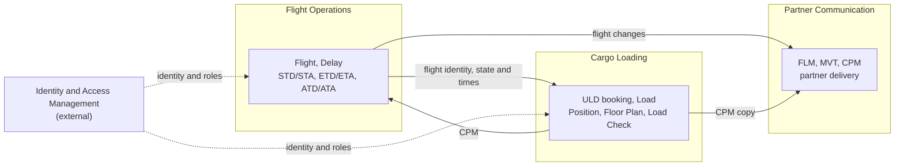
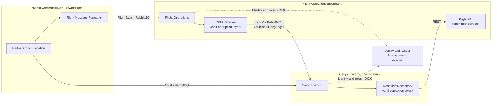
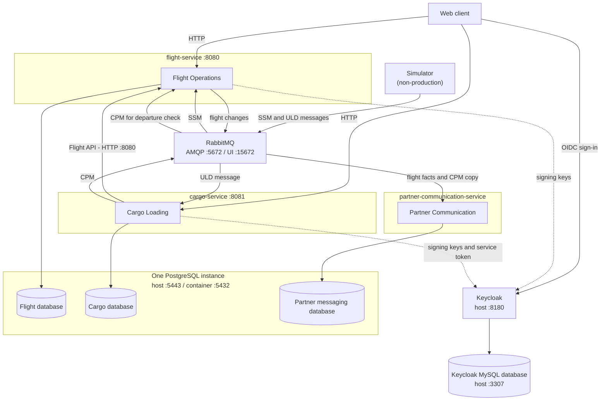
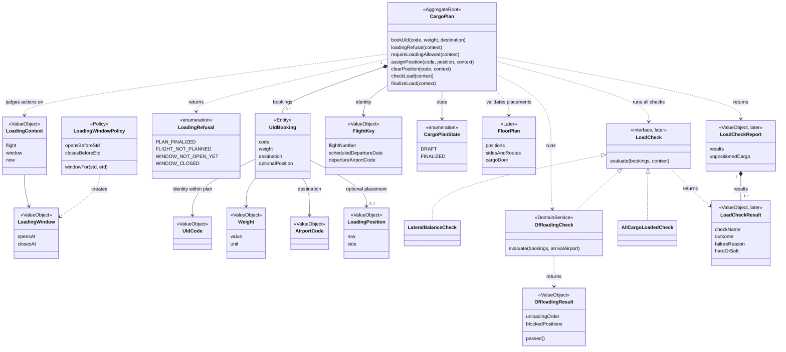
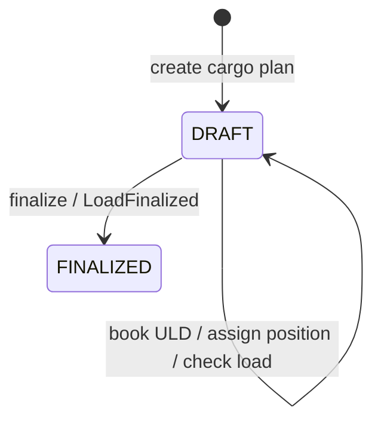
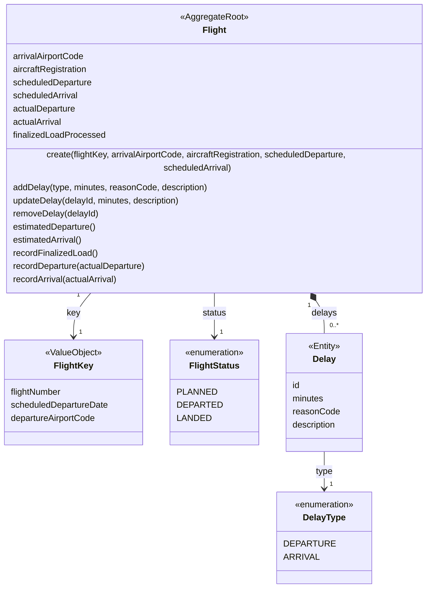
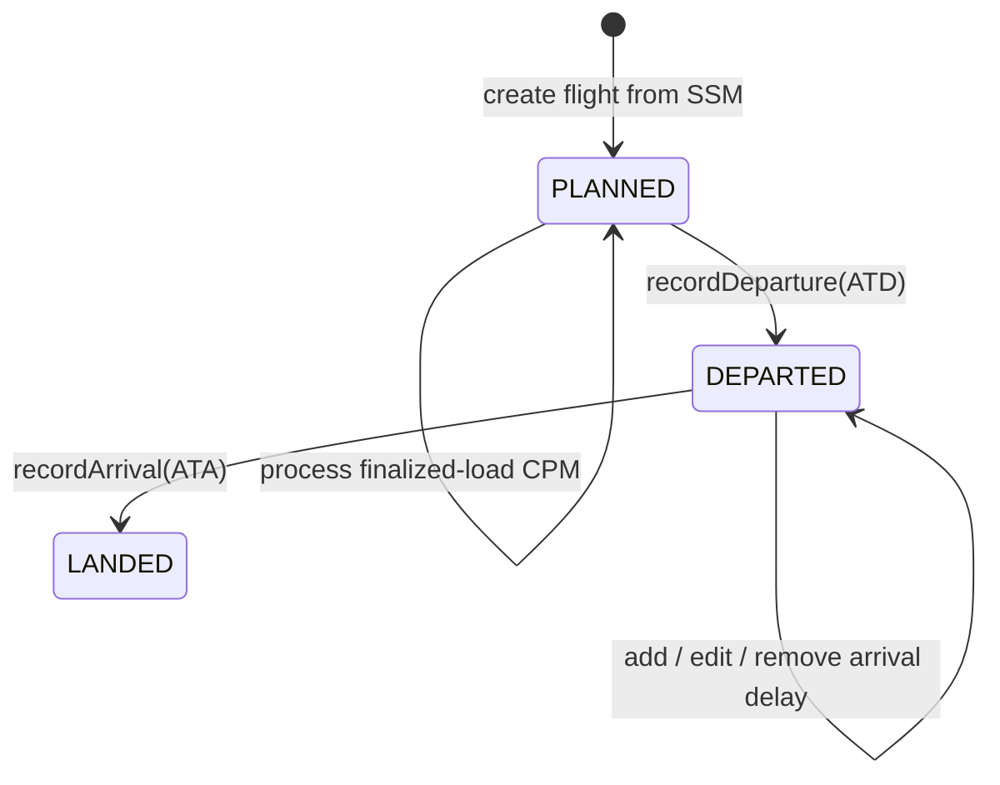
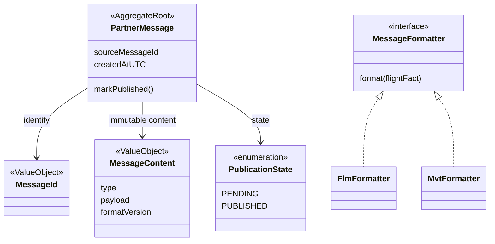
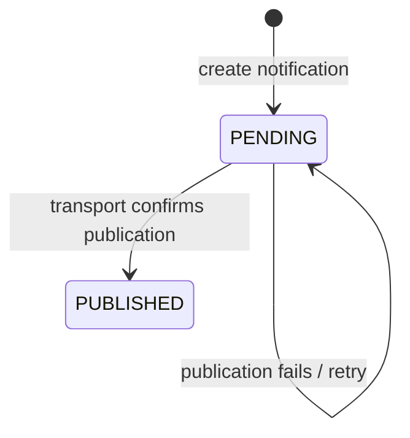

# Air Freight Operations

An airline carries cargo between airports on a fixed flight schedule. Flight planners record delays, their causes, and actual departure and arrival times. Load planners assign booked containers and pallets (ULDs) to aircraft positions, check the load, and finalize it.

Flight schedules and cargo bookings arrive from existing data feeds. The system keeps flight and load information current and creates standard IATA messages for other parties at the appropriate moments, even before any recipients are connected.

## 1. Subdomains

| Subdomain | Type | Rationale |
| --- | --- | --- |
| Flight Planning | Supporting | It keeps flight times and delays reliable so operations can respond. |
| Freight Loading | Core | Planning, checking and finalising the cargo load is central to this air-freight system. |
| Partner Messaging | Supporting | It creates the required flight and load messages for external parties when relevant events occur. |
| Identity and Access Management (IAM)          | Generic | Signing users in is a common problem handled by Keycloak; each operational context still enforces its own action rules. |

## 2. Bounded contexts

## 3. Ubiquitous language

| Term | Flight Operations | Cargo Loading | Partner Communication |
| --- | --- | --- | --- |
| Flight | Aggregate owning times, status and delays for one dated flight | Flight information used for bookings and load planning | Flight identity and facts used to prepare messages |
| FlightKey | Flight number, UTC scheduled departure date and departure airport code | Identifies the flight of a CargoPlan | Identifies the flight described by a message |
| Airport | Reference with IATA code and display name | Flight arrival and ULD destination codes used to check offloading | Airport code included in messages |
| STD / STA | Immutable scheduled departure / arrival times | STD anchors the loading-period start | Scheduled times included in FLM |
| ETD / ETA | Estimated departure / arrival times calculated from delays | ETD determines the loading-period end | Estimated times included in MVT-ED / MVT-EA |
| ATD / ATA | Recorded actual departure / arrival times | — | Actual times included in MVT-AD / MVT-AA |
| ULD | — | Unit Load Device (container or pallet) booked on a flight, with code, weight and destination; placement is optional | Positioned ULD details included in CPM |
| Weight | — | Value and unit used for cargo calculations | ULD weight and unit included in CPM |
| Loading position | — | Named place on the aircraft deck | ULD position included in CPM |
| Loading window | — | Period from STD - 12 hours to current ETD - 20 minutes in which a planned, unfinalized load may change; recomputed for every action | — |
| Finalized load | Processed CPM confirms the cargo prerequisite for departure | Checked, frozen load | Load snapshot carried in CPM |
| CPM | Received load message whose processing satisfies the cargo prerequisite for departure | Containers / Pallets Message describing the finalized load | Copy forwarded to partners |

## 4. Context map

| Relationship |Pattern | Why |
| --- | --- | --- |
| Flight Operations -> Cargo Loading | Open Host Service, Published Language; Cargo anti-corruption layer | Flight Operations exposes a flight-information contract; Cargo Loading translates it into its own model. |
| Cargo Loading -> Flight Operations | Published Language; Flight anti-corruption layer | Cargo Loading publishes CPM; Flight Operations translates it into its departure prerequisite. |
| Flight Operations -> Partner Communication | Published Language | Partner Communication formats flight facts into FLM/MVT messages. |
| Cargo Loading -> Partner Communication | Published Language | Partner Communication receives its own CPM copy for partner delivery. |

## 5. Deployment

- One PostgreSQL instance hosts three databases: one for Flight Operations, one for Cargo Loading and one for Partner Communication.
- Each service accesses only its own database. Services share information through APIs or RabbitMQ messages.
- Keycloak keeps its realm, clients and users in its own MySQL database, as in the course example.

## 6. Tactical design: Cargo Loading

| Building block | Elements |
| --- | --- |
| Aggregate root | `CargoPlan` (owns bookings) |
| Entity | `UldBooking` |
| Value objects | `FlightKey`, `UldCode`, `Weight`, `AirportCode`, `LoadingPosition`, `LoadingWindow`, `LoadingContext`, `OffloadingResult`, `LoadCheckResult` and `LoadCheckReport` (later) |
| Policy | `LoadingWindowPolicy` (configurable offsets) |
| Domain checks | `LateralBalanceCheck`, `OffloadingCheck` (domain service), `AllCargoLoadedCheck` |
| Domain event | `LoadFinalized` |
| Repository | `CargoPlanRepository` |
| Actors | Load planner |

Invariants on `CargoPlan`:

1. Unique ULD code per flight; one ULD per valid position, one position per ULD.
2. Booking only while planned. Placement, checking and finalization require a load planner, a planned flight, an open loading period and an unfinalized plan. `requireLoadingAllowed(context)` enforces the last three and is the first call of every such method; the load-planner role is checked before, by Spring Security (section 9).
3. Finalization reruns all checks; hard failures block it, soft failures warn.
4. Finalized load cannot change.

Every change to a cargo plan (booking, position, later finalization) raises the version of its `cargo_plans` row, and Hibernate checks that version at commit (optimistic locking). Of two overlapping changes the second is rolled back and the API answers 409; a unique constraint on (flight, position) also guards invariant 1 in the database. A ULD with a position moves to a free position in one step; swapping two ULDs takes two steps (team reading of Q16).

`LoadingPosition` is an enum of the 34 main-deck positions of the Boeing 747-400 freighter with row and side; with one aircraft type it is the floor plan's position list, and `OffloadingCheck` derives the routes from it. A second aircraft type would introduce a `FloorPlan` per type.

Marked *later* in the diagram: `LoadCheck`, `LoadCheckResult` and `LoadCheckReport` come with the full load report (#21) once a second check exists; `OffloadingCheck` then implements `LoadCheck`. `FloorPlan` only comes with a second aircraft type.

Loading period: **STD - 12 hours → current ETD - 20 minutes**

- Both offsets are settings (`cargo.loading-window.*`); `LoadingWindowPolicy` computes the window from STD and ETD only, so arrival times cannot move it.
- The window is half open: open at the opening instant, closed at the closing instant (team reading of Q06).
- It is never stored. The application service builds a `LoadingContext` per action from Flight's current data, the policy and an injected `Clock`, so a departure delay moves the end at the next action.
- The finalized state is checked first: a later delay never reopens a finalized plan.

### Load checks

| Check | Type | Rule |
| --- | --- | --- |
| Lateral balance | Hard | Heavier side ≤ 110% of lighter side, using a common weight unit; exclude A1, A2, B1 and X. Tolerance is configurable. |
| Offloading | Hard | Destination cargo must reach the door at RL without moving other-destination cargo, following the floor plan's routes and maneuvering rules. |
| Not all cargo loaded | Soft | Warn about bookings without a position. |

- All checks run.
- hard checks inspect positioned cargo only.

Offloading (#23, #24):

- `OffloadingCheck` is a package-private domain service in `domain.offloading`, alongside its result and tests. It is not yet called by `CargoPlan`; integration follows with Check Load (#21) and finalization (#26). It calls no guard; the action that runs it must call `requireLoadingAllowed` first.
- Routes follow the order of `LoadingPosition`. A paired position walks along its own side to row R: toward the tail in front of row R, toward the nose behind it. Left cargo leaves through RL; right cargo goes to RR and crosses to RL. A route never switches sides.
- The check simulates unloading on its own copy of the positions. In passes from nose to tail it removes every ULD for the arrival airport whose route is empty at that moment, until a pass removes nothing. Cargo for other airports never moves. The removal order is a legal unloading order (published example 2: RR, then UR); what remains is blocked. The cargo plan itself never changes.
- A route must be empty, not only free of other-airport cargo, so destination cargo on it leaves first. For paired positions this gives the same pass or fail as the case's wording, because the route of a position on my route is the rest of my route.
- Without destination cargo aboard the check passes (team reading).
- A1, A2, B1 and X have no own route and maneuver first (#24). A1, A2 and B1 need both CL and CR empty; X needs both UL and UR empty. Destination cargo there may leave first in an earlier pass. Then one clear side route is enough: the maneuvering position of that side plus its ordinary route, for example B1 right via CR, DR … PR, RR, RL and X left via UL, TL, SL, RL. The chosen side is not reported.
- A1, A2 and B1 do not block each other (team reading of Q16, taken from the #24 issue text; open question for the coach).
- Single and paired positions form one Offloading check: the same simulation, only the condition to leave differs.

### Lifecycle and finalization handoff

- A departure delay never moves a plan from `FINALIZED` back to `DRAFT`; there is no unfinalize operation.
- `LoadFinalized` carries the flight key and frozen positioned cargo, used to publish CPM.
- CPM goes via RabbitMQ to Flight Operations and Partner Communication. Departure requires Flight Operations to have received and processed it.

## 7. Tactical design: Flight Operations

| Building block | Elements |
| --- | --- |
| Aggregate root | `Flight` (owns delays and controls the lifecycle) |
| Entity | `Delay` |
| Value objects | `FlightKey` (a delay's `id` is a plain `UUID`, no value object) |
| Enumerations | `FlightStatus`, `DelayType` |
| Domain events | `FlightCreated`, `FlightEstimatesChanged`, `FlightDeparted`, `FlightArrived` |
| Repository | `FlightRepository` |
| Actors | Flight planner, Load planner |

Invariants on `Flight`:

1. `FlightKey`, scheduled departure and scheduled arrival cannot change. The key's `scheduledDepartureDate` is the UTC date of the original scheduled departure.
2. A flight moves only from `PLANNED` to `DEPARTED` to `LANDED`.
3. Departure delays can change only while planned, arrival delays can change while planned or departed. All delays freeze after landing.
4. Each delay is 1–720 minutes. ETD and ETA are calculated from the current delays, never entered manually.

### Flight workflow

- SSM creates `PLANNED` flights without delays or actual times; `finalizedLoadProcessed` starts false. Duplicate keys are logged and skipped unchanged; remaining dates continue.
- `recordFinalizedLoad()` marks the CPM as received and processed by Flight Operations.

### Flight lifecycle

## 8. Tactical design: Partner Communication

| Building block | Elements |
| --- | --- |
| Aggregate root | `PartnerMessage` |
| Value objects | `MessageId`, `MessageContent` |
| Domain services | `FlmFormatter`, `MvtFormatter` |
| Repository | `PartnerMessageRepository` |
| Actors | Partners |

### Message triggers

| Source fact | Outgoing message |
| --- | --- |
| Flight created | FLM (JSON) |
| ETD changed | MVT-ED + MVT-EA (IATA text) |
| ETA only changed | MVT-EA (IATA text) |
| ATD / ATA registered | MVT-AD / MVT-AA (IATA text) |
| CPM received from Cargo | CPM copy (JSON) |

### Publication lifecycle

- `PUBLISHED` means transport confirmation.

## 9. Layering 

Each service uses `domain` for business rules and repository interfaces, `application` for use cases, `infrastructure` for persistence and external adapters, and `api` for REST controllers, DTOs and mappers. The initial setup contains these packages; business workflows are still to be implemented.

A service serves its own web pages as static files from its JAR. Cargo and Flight each have separate frontend and backend Gradle projects under `cargo/` and `flight/`. Vite builds each frontend's HTML, TypeScript and Tailwind CSS into its `build/dist/` directory. The backend's resource processing adds that output to its JAR as `static/`, without writing generated files into `src/`. Cargo preserves its page URLs and its `static/js` and `static/css` asset paths. The pages render on the client: the TypeScript modules call the service's REST API with `fetch` and a bearer token.

Sign-in and rights: the page (bundled with `keycloak-js`) sends the user to Keycloak's own login page (OpenID Connect, Authorization Code with PKCE), keeps the tokens in memory and renews the access token before an API call when it is about to expire. Flight and Cargo are stateless resource servers: each checks every JWT itself with Keycloak's public keys (signature, issuer, its own audience, expiry) and maps the realm roles `flight-planner` and `load-planner` to Spring roles. The rules live in each service's `SecurityConfiguration`: both roles may read (`GET /api/**`), other API calls need `load-planner` in Cargo and `flight-planner` in Flight. Cargo lets only its page files, health and `/error` through without a token and refuses every other path. A missing or invalid token gives 401, a wrong role 403; a refusal by the domain rules stays 409. The pages hide actions the role may not use, but the server decides. Cargo reads Flight with its own client-credentials token.

Cargo signals a missing or invalid input value with its own `InvalidCargoValueException` from the value objects. The ULD listener stores such a message in `rejected_messages` without retrying; a REST controller turns it into 400 only while it builds the domain values from the URL, so bad data from Flight stays a 500. `CargoApiExceptionHandler` gives every Cargo endpoint the same answers: 404 for a flight Flight does not know, 503 when Flight is unreachable, 409 with a refusal code when the loading rules refuse an action (`LoadingNotAllowedException`). Read use cases such as the cargo plan view (`CargoPlanQueryService`) load the aggregate through its repository and add Flight's data; they check no flight state, so the plan stays readable after departure.

## 10. Running it 

Run `docker compose up -d --build` from the repository root. See [README](../README.md) for ports, development credentials, IntelliJ setup and the current implementation limits. Configure Keycloak first as the README describes. Health endpoints verify PostgreSQL and RabbitMQ; Cargo also checks its HTTP connection to Flight. Flight and Cargo validate Keycloak tokens and enforce the planner roles (section 9).
