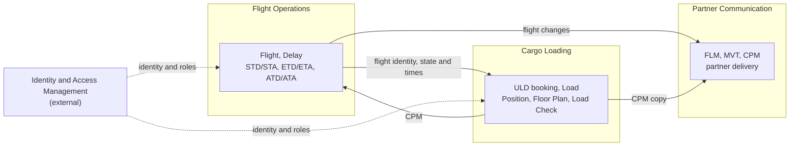
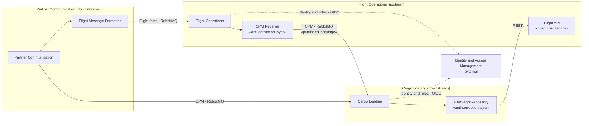
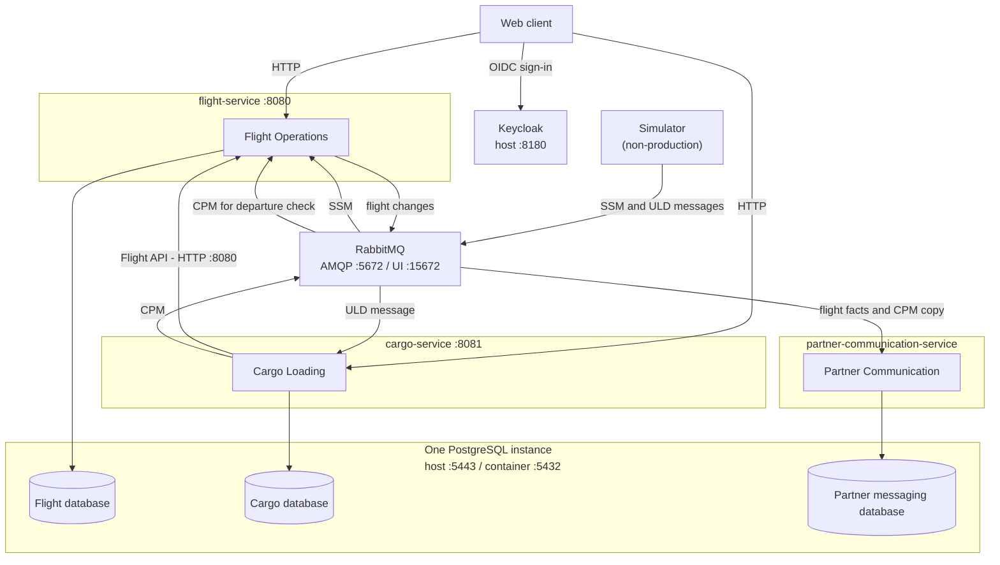
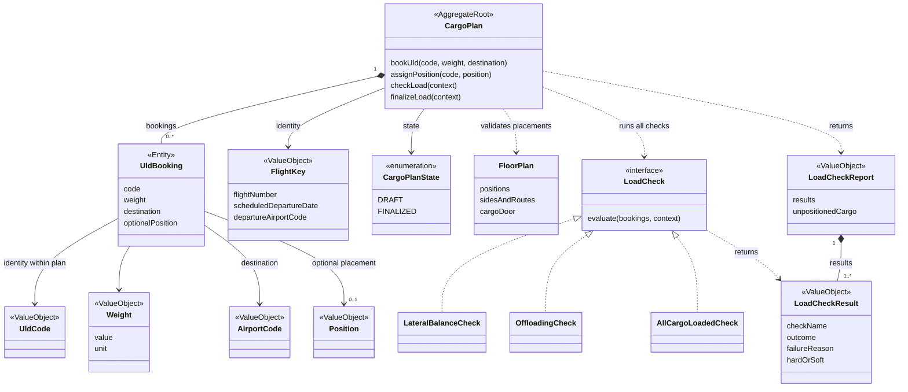
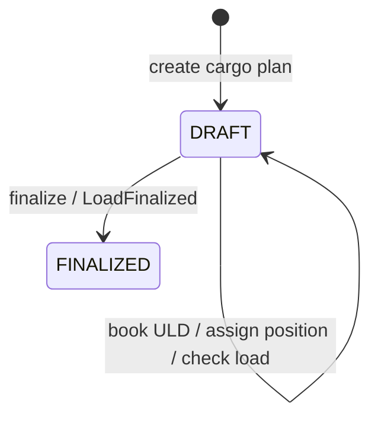
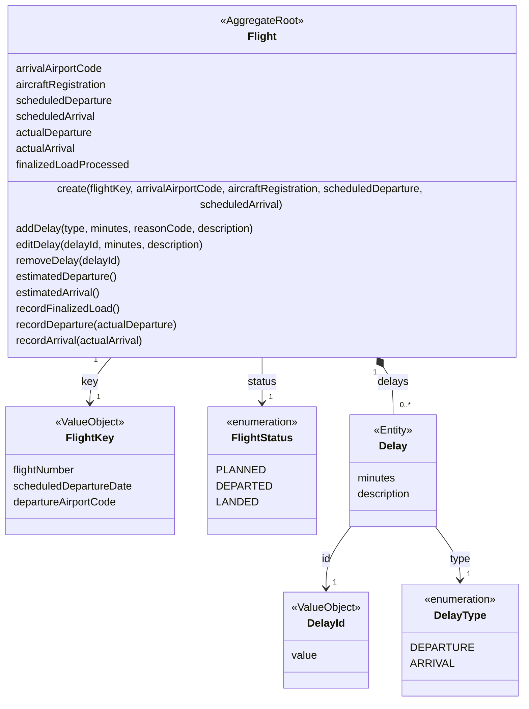
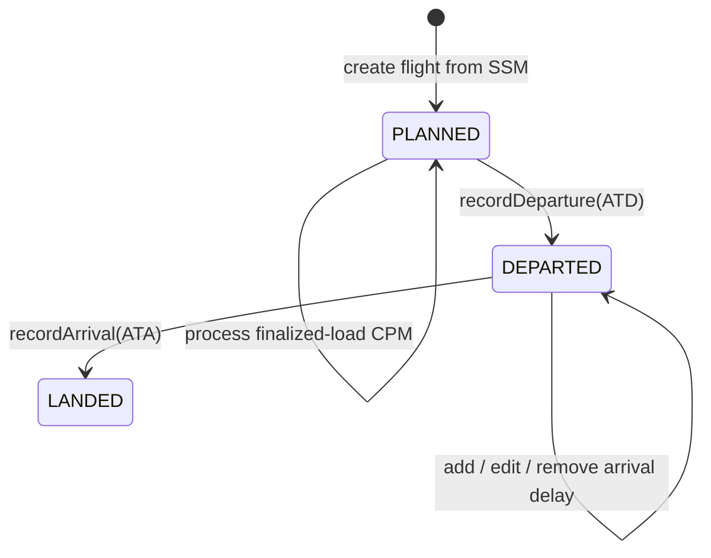
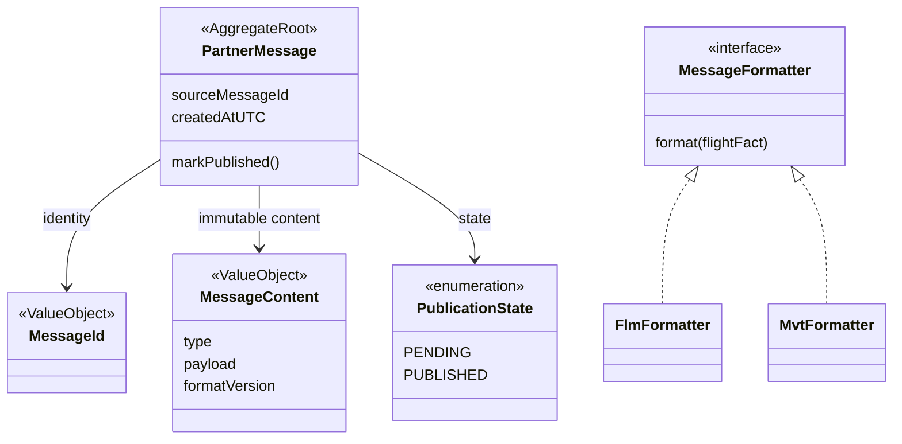
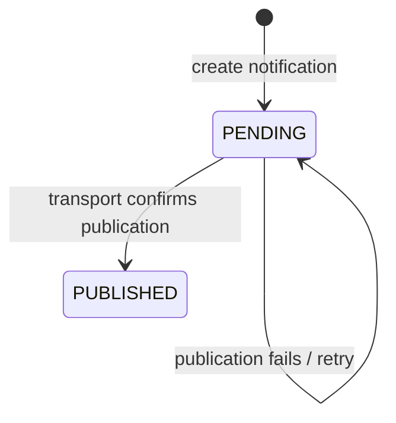

# Air Freight Operations

An airline carries cargo between airports on a fixed flight schedule. Flight planners record delays, their causes, and actual departure and arrival times. Load planners assign booked containers and pallets (ULDs) to aircraft positions, check the load, and finalize it.

Flight schedules and cargo bookings arrive from existing data feeds. The system keeps flight and load information current and creates standard IATA messages for other parties at the appropriate moments, even before any recipients are connected.

## 1. Subdomains

| Subdomain | Type | Rationale |
| --- | --- | --- |
| Flight Planning | Supporting | It keeps flight times and delays reliable so operations can respond. |
| Freight Loading | Core | Planning, checking and finalising the cargo load is central to this air-freight system. |
| Partner Messaging | Supporting | It creates the required flight and load messages for external parties when relevant events occur. |
| Identity and Access Management (IAM)          | Generic | Signing users in is a common problem handled by Keycloak; each operational context still enforces its own action rules. |

## 2. Bounded contexts

## 3. Ubiquitous language

| Term | Flight Operations | Cargo Loading | Partner Communication |
| --- | --- | --- | --- |
| Flight | Aggregate owning times, status and delays for one dated flight | Flight information used for bookings and load planning | Flight identity and facts used to prepare messages |
| FlightKey | Flight number, UTC scheduled departure date and departure airport code | Identifies the flight of a CargoPlan | Identifies the flight described by a message |
| Airport | Reference with IATA code and display name | Flight arrival and ULD destination codes used to check offloading | Airport code included in messages |
| STD / STA | Immutable scheduled departure / arrival times | STD anchors the loading-period start | Scheduled times included in FLM |
| ETD / ETA | Estimated departure / arrival times calculated from delays | ETD determines the loading-period end | Estimated times included in MVT-ED / MVT-EA |
| ATD / ATA | Recorded actual departure / arrival times | — | Actual times included in MVT-AD / MVT-AA |
| ULD | — | Unit Load Device (container or pallet) booked on a flight, with code, weight and destination; placement is optional | Positioned ULD details included in CPM |
| Weight | — | Value and unit used for cargo calculations | ULD weight and unit included in CPM |
| Loading position | — | Named place on the aircraft deck | ULD position included in CPM |
| Finalized load | Processed CPM confirms the cargo prerequisite for departure | Checked, frozen load | Load snapshot carried in CPM |
| CPM | Received load message whose processing satisfies the cargo prerequisite for departure | Containers / Pallets Message describing the finalized load | Copy forwarded to partners |

## 4. Context map

| Relationship |Pattern | Why |
| --- | --- | --- |
| Flight Operations -> Cargo Loading | Open Host Service, Published Language; Cargo anti-corruption layer | Flight Operations exposes a flight-information contract; Cargo Loading translates it into its own model. |
| Cargo Loading -> Flight Operations | Published Language; Flight anti-corruption layer | Cargo Loading publishes CPM; Flight Operations translates it into its departure prerequisite. |
| Flight Operations -> Partner Communication | Published Language | Partner Communication formats flight facts into FLM/MVT messages. |
| Cargo Loading -> Partner Communication | Published Language | Partner Communication receives its own CPM copy for partner delivery. |

## 5. Deployment

- One PostgreSQL instance hosts three databases: one for Flight Operations, one for Cargo Loading and one for Partner Communication.
- Each service accesses only its own database. Services share information through APIs or RabbitMQ messages.

## 6. Tactical design: Cargo Loading

| Building block | Elements |
| --- | --- |
| Aggregate root | `CargoPlan` (owns bookings) |
| Entity | `UldBooking` |
| Value objects | `FlightKey`, `UldCode`, `Weight`, `AirportCode`, `Position`, `LoadCheckResult`, `LoadCheckReport` |
| Domain checks | `LateralBalanceCheck`, `OffloadingCheck`, `AllCargoLoadedCheck` |
| Domain event | `LoadFinalized` |
| Repository | `CargoPlanRepository` |
| Actors | Load planner |

Invariants on `CargoPlan`:

1. Unique ULD code per flight; one ULD per valid position, one position per ULD.
2. Booking only while planned. Placement, checking and finalization require a load planner, a planned flight, an open loading period and an unfinalized plan.
3. Finalization reruns all checks; hard failures block it, soft failures warn.
4. Finalized load cannot change.

Loading period: **STD - 12 hours → current ETD - 20 minutes**

### Load checks

| Check | Type | Rule |
| --- | --- | --- |
| Lateral balance | Hard | Heavier side ≤ 110% of lighter side, using a common weight unit; exclude A1, A2, B1 and X. Tolerance is configurable. |
| Offloading | Hard | Destination cargo must reach the door at RL without moving other-destination cargo, following the floor plan's routes and maneuvering rules. |
| Not all cargo loaded | Soft | Warn about bookings without a position. |

- All checks run.
- hard checks inspect positioned cargo only.

### Lifecycle and finalization handoff

- `LoadFinalized` carries the flight key and frozen positioned cargo, used to publish CPM.
- CPM goes via RabbitMQ to Flight Operations and Partner Communication. Departure requires Flight Operations to have received and processed it.

## 7. Tactical design: Flight Operations

| Building block | Elements |
| --- | --- |
| Aggregate root | `Flight` (owns delays and controls the lifecycle) |
| Entity | `Delay` |
| Value objects | `FlightKey`, `DelayId` |
| Enumerations | `FlightStatus`, `DelayType` |
| Domain events | `FlightCreated`, `FlightEstimatesChanged`, `FlightDeparted`, `FlightArrived` |
| Repository | `FlightRepository` |
| Actors | Flight planner, Load planner |

Invariants on `Flight`:

1. `FlightKey`, scheduled departure and scheduled arrival cannot change. The key's `scheduledDepartureDate` is the UTC date of the original scheduled departure.
2. A flight moves only from `PLANNED` to `DEPARTED` to `LANDED`.
3. Departure delays can change only while planned, arrival delays can change while planned or departed. All delays freeze after landing.
4. Each delay is 1–720 minutes. ETD and ETA are calculated from the current delays, never entered manually.

### Flight workflow

- SSM creates `PLANNED` flights without delays or actual times; `finalizedLoadProcessed` starts false. Duplicate keys are logged and skipped unchanged; remaining dates continue.
- `recordFinalizedLoad()` marks the CPM as received and processed by Flight Operations.

### Flight lifecycle

## 8. Tactical design: Partner Communication

| Building block | Elements |
| --- | --- |
| Aggregate root | `PartnerMessage` |
| Value objects | `MessageId`, `MessageContent` |
| Domain services | `FlmFormatter`, `MvtFormatter` |
| Repository | `PartnerMessageRepository` |
| Actors | Partners |

### Message triggers

| Source fact | Outgoing message |
| --- | --- |
| Flight created | FLM (JSON) |
| ETD changed | MVT-ED + MVT-EA (IATA text) |
| ETA only changed | MVT-EA (IATA text) |
| ATD / ATA registered | MVT-AD / MVT-AA (IATA text) |
| CPM received from Cargo | CPM copy (JSON) |

### Publication lifecycle

- `PUBLISHED` means transport confirmation.

## 9. Layering 

_TODO_

## 10. Running it 

_TODO_
