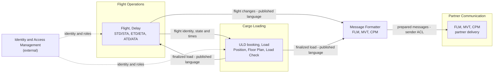
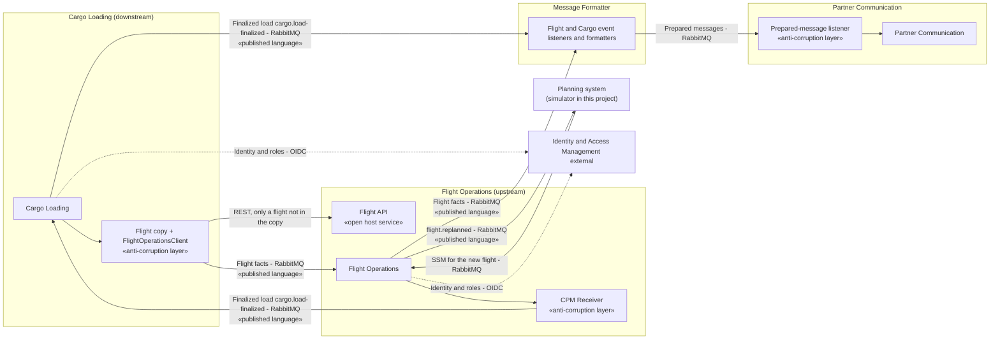
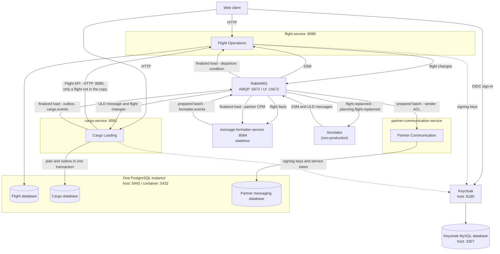
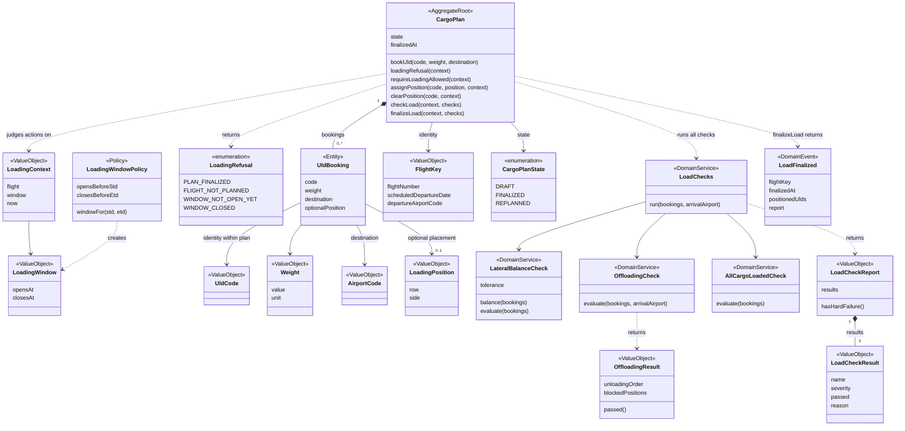
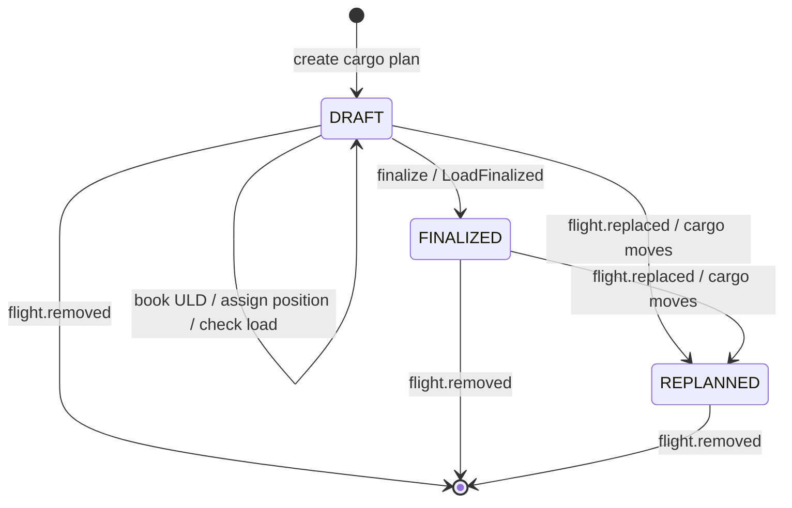
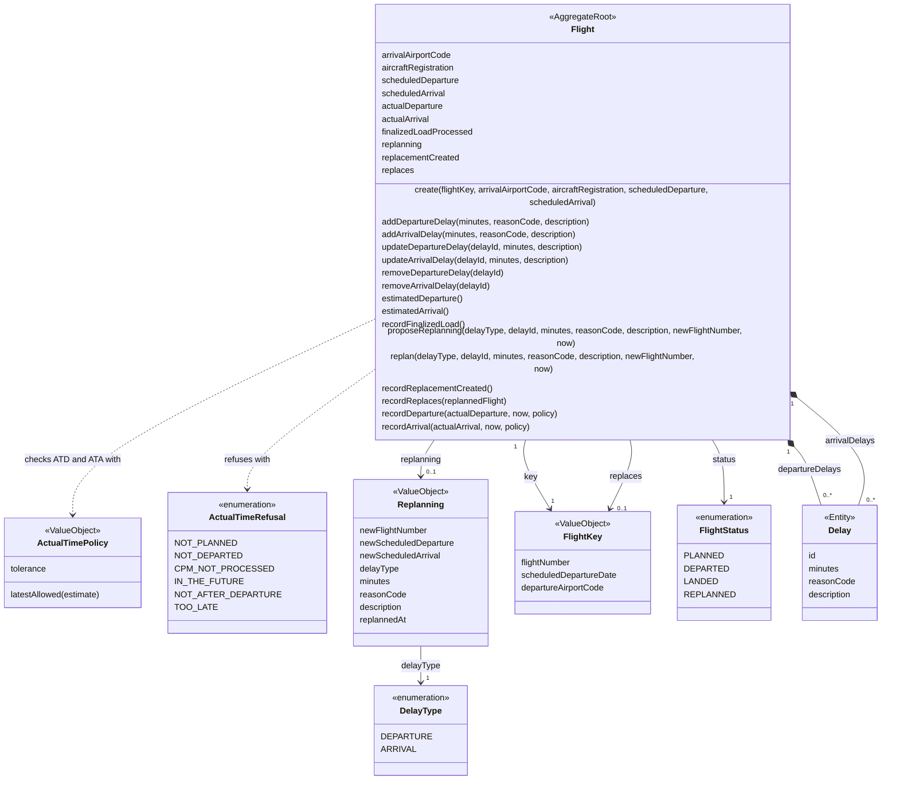
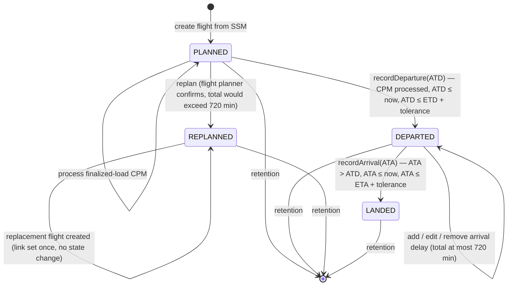
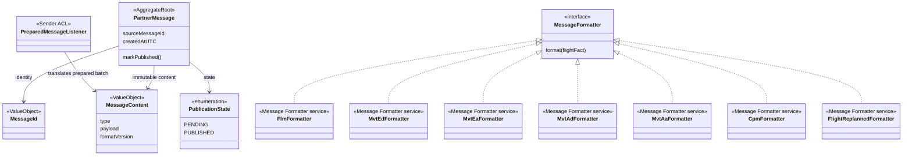
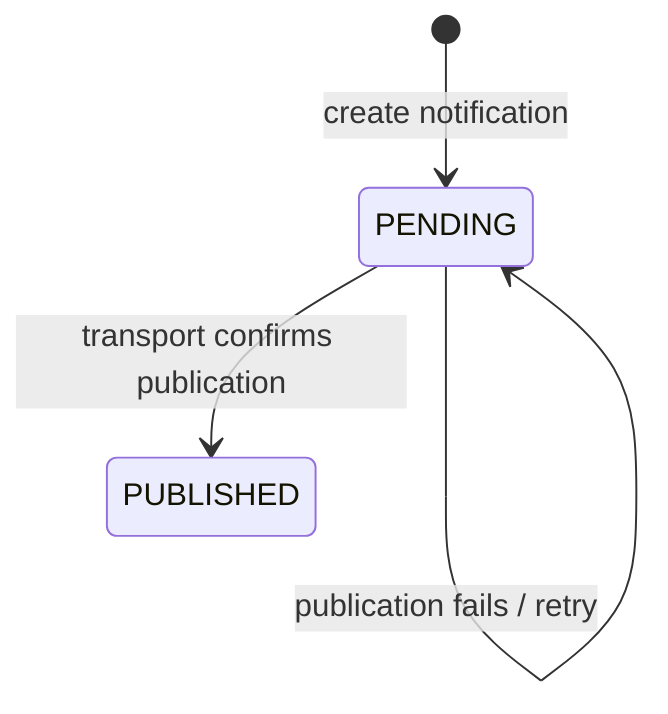

# Air Freight Operations

An airline carries cargo between airports on a fixed flight schedule. Flight planners record delays, their causes, and actual departure and arrival times. Load planners assign booked containers and pallets (ULDs) to aircraft positions, check the load, and finalize it.

Flight schedules and cargo bookings arrive from existing data feeds. The system keeps flight and load information current and creates standard IATA messages for other parties at the appropriate moments, even before any recipients are connected.

## 1. Subdomains

| Subdomain | Type | Rationale |
| --- | --- | --- |
| Flight Planning | Supporting | It keeps flight times and delays reliable so operations can respond. |
| Freight Loading | Core | Planning, checking and finalising the cargo load is central to this air-freight system. |
| Partner Messaging | Supporting | It creates the required flight and load messages for external parties when relevant events occur. |
| Identity and Access Management (IAM)          | Generic | Signing users in is a common problem handled by Keycloak; each operational context still enforces its own action rules. |

## 2. Bounded contexts

## 3. Ubiquitous language

| Term | Flight Operations | Cargo Loading | Message Formatter / Partner Communication |
| --- | --- | --- | --- |
| Flight | Aggregate owning times, status and delays for one dated flight | Flight information used for bookings and load planning | Flight identity and facts used to prepare messages |
| FlightKey | Flight number, UTC scheduled departure date and departure airport code | Identifies the flight of a CargoPlan | Identifies the flight described by a message |
| Airport | Reference with IATA code and display name | Flight arrival and ULD destination codes used to check offloading | Airport code included in messages |
| STD / STA | Immutable scheduled departure / arrival times | STD anchors the loading-period start | Scheduled times included in FLM |
| ETD / ETA | Estimated departure / arrival times calculated from delays | ETD determines the loading-period end | Estimated times included in MVT-ED / MVT-EA |
| ATD / ATA | Recorded actual departure / arrival times | — | Actual times included in MVT-AD / MVT-AA |
| ULD | — | Unit Load Device (container or pallet) booked on a flight, with code, weight and destination; placement is optional | Positioned ULD details included in CPM |
| Weight | — | Value and unit used for cargo calculations | ULD weight and unit included in CPM |
| Loading position | — | Named place on the aircraft deck | ULD position included in CPM |
| Loading window | — | Period from STD - 12 hours to current ETD - 20 minutes in which a planned, unfinalized load may change; recomputed for every action | — |
| Finalized load | Processed CPM confirms the cargo prerequisite for departure | Checked, frozen load | Load snapshot carried in CPM |
| CPM | Received load message whose processing satisfies the cargo prerequisite for departure | Containers / Pallets Message describing the finalized load | Copy forwarded to partners |

## 4. Context map

| Relationship |Pattern | Why |
| --- | --- | --- |
| Flight Operations -> Cargo Loading | Published Language (flight events) and Open Host Service for one unknown flight; Cargo anti-corruption layer | Cargo keeps its own copy of the flights it needs, so it keeps working while Flight is down, and asks the API only for a flight that is not in the copy yet. Both paths are translated into Cargo's own model. |
| Cargo Loading -> Flight Operations | Published Language; Flight anti-corruption layer | Cargo Loading publishes the finalized load (`cargo.load-finalized`); Flight's `CpmReceiver` translates it into its departure prerequisite. |
| Flight Operations / Cargo Loading -> Message Formatter | Published Language | Formatter consumes Flight facts for FLM/MVT and Cargo's finalized load for the partner CPM. Cargo never formats the partner CPM. |
| Message Formatter -> Partner Communication | Sender anti-corruption layer | Sender translates prepared batches into its own message model, persists them and publishes them. |
| Flight Operations -> Planning system | Published Language (`flight.replanned`), Conformist back | Flight ends the old flight and publishes the proposed schedule; the planning system (the simulator here) answers with a normal SSM, so the new flight enters like every other flight. |

## 5. Deployment

- One PostgreSQL instance hosts three databases, and each service only accesses its own. Services share information through APIs or RabbitMQ.
- Flight and Cargo each have an `outbox_messages` table: an event is written in the same transaction as the change and sent after the commit with publisher confirms. A scheduled job resends what is pending with the same message ID.
- The simulator is not deployed. It also plays the external planning system for replanning.
- Keycloak keeps its realm, clients and users in its own MySQL database.

## 6. Tactical design: Cargo Loading

| Building block | Elements |
| --- | --- |
| Aggregate root | `CargoPlan` (owns bookings) |
| Entity | `UldBooking` |
| Value objects | `FlightKey`, `UldCode`, `Weight`, `AirportCode`, `LoadingPosition`, `LoadingWindow`, `LoadingContext`, `OffloadingResult`, `LateralBalance`, `LoadCheckResult`, `LoadCheckReport` |
| Policy | `LoadingWindowPolicy` (configurable offsets); lateral balance tolerance (configurable) |
| Domain checks | `LoadChecks` runs `LateralBalanceCheck`, `OffloadingCheck` and `AllCargoLoadedCheck` (domain services) |
| Domain event | `LoadFinalized` |
| Repository | `CargoPlanRepository` |
| Actors | Load planner |

Invariants on `CargoPlan`:

1. Unique ULD code per flight; one ULD per valid position, one position per ULD.
2. Booking only while planned. Placement, checking and finalization need a planned flight, an open loading period and an unfinalized plan (`requireLoadingAllowed`); the role is checked before, by Spring Security.
3. Finalization reruns all checks; hard failures block it, soft failures warn.
4. Finalized load cannot change.
5. The cargo of a replanned flight moves once to the plan of the new flight: bookings keep their position unless it is taken there, and the new plan is a `DRAFT`, also after a finalized load, so the load planner checks and finalizes again. The old plan ends as `REPLANNED` with `movedTo`.

Every change raises the version of the `cargo_plans` row (optimistic locking): of two overlapping changes the second is rolled back with 409, and a unique constraint on (flight, position) guards invariant 1 in the database. A ULD moves to a free position in one step; swapping two ULDs takes two (team reading of Q16).

`LoadingPosition` is an enum of the 34 main-deck positions of the Boeing 747-400 freighter. A second aircraft type would introduce a floor plan per type. The three checks have different inputs, so there is no common interface; `LoadChecks` calls them in a fixed order and builds one report.

Loading period: **STD - 12 hours → current ETD - 20 minutes**

- Both offsets are settings, and only STD and ETD count, so arrival times cannot move the window.
- The window is half open: open at the opening instant, closed at the closing instant (team reading of Q06).
- It is never stored. A `LoadingContext` is built per action from Flight's current data, so a departure delay moves the end at the next action.

### Load checks

| Check | Type | Rule |
| --- | --- | --- |
| Lateral balance | Hard | Heavier side ≤ 110% of lighter side, using a common weight unit; exclude A1, A2, B1 and X. Tolerance is configurable. |
| Offloading | Hard | Destination cargo must reach the door at RL without moving other-destination cargo, following the floor plan's routes and maneuvering rules. |
| Not all cargo loaded | Soft | Warn about bookings without a position. |

- All checks run, also after an earlier one failed, and every result has a name, type, outcome and reason. Checking changes nothing.
- Hard checks inspect positioned cargo only.
- A check is refused outside the window and after finalizing (team reading of Q17: Check Load is a loading action).

Lateral balance (#22):

- Left and right are the sums of the L and R positions, compared in kg, the unit we chose (the course names none). LB uses the exact factor 0.45359237 (Q15).
- `heavier <= lighter × (1 + tolerance)` with exact decimals: 1000/1100 passes, 1000/1101 fails.
- From the formula, not a course case: an empty load passes and cargo on only one side fails.
- The tolerance is a setting, default `0.10`; changing it needs a restart, not a release (Q21 stays open).

Offloading (#23, #24):

- `OffloadingCheck` simulates unloading on its own copy of the positions. In passes from nose to tail it removes every ULD for the arrival airport whose route is empty; what remains is blocked. Cargo for other airports never moves.
- Routes follow the order of `LoadingPosition`: along the own side to row R, leaving through RL, and right cargo crosses from RR to RL. A route never switches sides.
- A1, A2, B1 and X have no route of their own and maneuver first: A1, A2 and B1 need CL and CR empty, X needs UL and UR empty. Then one clear side route is enough.
- Without destination cargo aboard the check passes. A1, A2 and B1 do not block each other (team readings of Q16; open question for the coach).

### Lifecycle and finalization handoff

- A departure delay never reopens a finalized plan; there is no unfinalize.
- `finalizeLoad` reruns all checks. A hard failure changes nothing (409 `HARD_CHECKS_FAILED` with the report); soft warnings do not block. A plan without positioned cargo can be finalized, with an empty ULD list (D3).
- After finalizing, positions, checks and a second finalize refuse with `PLAN_FINALIZED`. A new ULD booking goes to `rejected_messages`; a repeat of an existing booking stays an ignored duplicate (D4, our reading of CAR-14 and Q07).
- `LoadFinalized` is written to the outbox in the same transaction and sent as `cargo.load-finalized` on `cargo.events` ([contract](../README.md#messages)). Flight (departure condition) and the Formatter (partner CPM) each bind their own queue. Cargo never formats the partner CPM.
- Team reading of Q10/Q11: Flight's processing of `cargo.load-finalized` is the receipt of the CPM. A resend keeps its message ID, so a duplicate has no second effect in Flight or Partner.

## 7. Tactical design: Flight Operations

| Building block | Elements |
| --- | --- |
| Aggregate root | `Flight` (owns delays and controls the lifecycle) |
| Entity | `Delay` |
| Value objects | `FlightKey`, `ActualTimePolicy`, `RetentionPolicy`, `Replanning` (a delay's `id` is a plain `UUID`, no value object) |
| Enumerations | `FlightStatus`, `DelayType`, `ActualTimeRefusal` |
| Reference data | `DelayReason`, `Airport` (an unlisted code is shown without a name) |
| Domain events | `FlightCreated`, `FlightEstimatesChanged`, `FlightDeparted`, `FlightLanded`, `FlightReplanned`, `FlightReplaced`, `FlightRemoved` |
| Repositories | `FlightRepository`, `DelayReasonRepository`, `AirportRepository` |
| Actors | Flight planner, Load planner |

Invariants on `Flight`:

1. `FlightKey`, scheduled departure and scheduled arrival cannot change. The key's `scheduledDepartureDate` is the UTC date of the original scheduled departure. Flight numbers contain 1–32 letters or digits, matching Cargo's accepted format.
2. A flight moves only from `PLANNED` to `DEPARTED` to `LANDED`, or from `PLANNED` to `REPLANNED`. `REPLANNED` is final: no delay changes, no second replanning, no CPM, no departure.
3. Departure delays can change only while planned, arrival delays can change while planned or departed. All delays freeze after landing and after replanning.
4. Each delay is 1–720 minutes, and all delays of a flight together (departure and arrival) are at most 720 minutes (coach). A change that would pass that total is refused with 409 `TOTAL_DELAY_EXCEEDED`. ETD and ETA are calculated from the current delays, never entered manually.
5. Actual times are registered once and never change; a second registration is refused.
6. ATD needs the processed CPM, is at most `now` and at most ETD plus the tolerance; ATA is later than ATD, at most `now` and at most ETA plus the tolerance. The limit itself is accepted. The tolerance (`ActualTimePolicy`, 5 minutes) is configuration; `now` comes from the service's clock, so the aggregate stays testable.

### Flight workflow

- SSM creates `PLANNED` flights without delays or actual times. Duplicate keys are logged and skipped; the remaining dates continue.
- An unreadable or invalid SSM creates nothing and throws in `SsmRabbitListener`. After the retries `FlightMessageRecoverer` stores it in `rejected_messages` and dead-letters it. Repeated and overlapping valid SSMs throw nothing, so they are never stored as rejected.
- `CpmReceiver` (anti-corruption layer) checks `cargo.load-finalized` and calls `FinalizedLoadService`, which locks the flight row, skips a known message ID and records the load in one transaction. Invalid messages take the same path as an invalid SSM.
- `recordDeparture` refuses with `CPM_NOT_PROCESSED` until the CPM is processed. The CPM listener and the registration lock the same row, so they never interleave.
- `recordDeparture` and `recordArrival` check the rules of invariant 6, then store the time and change the status. `FlightActualTimeService` publishes `FlightDeparted` or `FlightLanded` through the outbox. A refused registration publishes nothing and registering changes no estimate, so no ED or EA follows.

### Replanning (out of scope, built anyway)

The course says a flight held for more than twelve hours is replanned outside this system; only the 12 h total (invariant 4) is required. We still let a planner start it, because otherwise such a flight is stuck.

- A refused delay change (409 `TOTAL_DELAY_EXCEEDED`) carries the proposal, calculated by the same code as the replan itself. Only an explicit `POST .../replanning` replans, and the server checks everything again.
- New STD = STD + all departure delays, new STA = STA + all delays, the requested change included. The new flight gets the old number plus the next free letter (HJ500 → HJ500A), so its key is always free. The old flight keeps its delays, so no MVT is sent.
- `flight.replanned` goes through the outbox to the planning system, which answers with a normal SSM. Flight declares that queue itself, because with mandatory publishing a missing queue would silently lose the event.
- When that SSM creates the expected flight, Flight links both flights in the same transaction and publishes `flight.replaced`. Only then does Cargo move the cargo, because the new flight may never come (documented limitation: the old flight then waits).

### Flight lifecycle

`DEPARTED` freezes the departure delays, `LANDED` all delays; actual times never change. `REPLANNED` is final: delay changes, a second replan and ATD/ATA are refused. The "replacement created" link is a flag, not a state, like `finalizedLoadProcessed`.

### Retention (#39, team reading of Q12, to confirm)

Flight owns the lifecycle, so the rule and its setting exist once. `FlightCleanupJob` removes a flight with its delays and CPM dedup rows and writes `flight.removed` to the outbox in one transaction. Cargo then removes the plan, bookings, ULD dedup rows and flight copy. Cargo down means the message waits in `cargo.flight-removed`; a broker outage means it waits in the outbox. Until then Flight answers 404 and Cargo still shows the flight from its copy, or "Flight not found" without a copy row (decided by the user).

- Cut-off: 00:00 UTC on the key date plus the retention, that instant included. With 7 days a flight of 29 October expires on 5 November at 00:00 UTC, in any status. Delays and the time of day do not count.
- Frequency: at startup and then every hour, so a flight is gone at most one interval after the cut-off.
- Never touched: pending outbox rows, `PENDING` partner messages and queues. They are delivered after the removal. A late CPM ends in `rejected_messages`, a late estimate in Cargo is logged and skipped.
- A published outbox row expires like a flight of its publication day: every run in Flight, on `flight.removed` in Cargo with that flight's date, so Cargo needs no retention setting.
- Stay: `rejected_messages`, the DLQs, logs, `message_receipts` (only an ID and a time; a resent ULD keeps its old date and is rejected) and `partner_messages` (the record of what was sent).
- Replanned flights go like any other. Moved cargo goes with the new flight, and the new flight's `replaces` keeps the old key; the columns have no foreign key.
- An SSM is handled the same whatever its date: an expired flight is created and goes at the next run, also when a duplicate SSM recreates a removed flight, which sends a second FLM.

## 8. Tactical design: Message Formatter and Partner Communication

| Building block | Elements |
| --- | --- |
| Aggregate root | `PartnerMessage` |
| Value objects | `MessageId`, `MessageContent` |
| Formatter implementations | `FlmFormatter`, `MvtEdFormatter`, `MvtEaFormatter`, `MvtAdFormatter`, `MvtAaFormatter`, `CpmFormatter`, `FlightReplannedFormatter` in Message Formatter |
| Repository | `PartnerMessageRepository` |
| Actors | Partners |

### Message triggers

| Source fact | Outgoing message |
| --- | --- |
| Flight created | FLM (JSON) |
| ETD changed | MVT-ED + MVT-EA (IATA text) |
| ETA only changed | MVT-EA (IATA text) |
| ATD / ATA registered | MVT-AD / MVT-AA (IATA text); line 2 keeps the scheduled departure day |
| Load finalized in Cargo | CPM (JSON): flight number, scheduled departure date, departure airport, and only the positioned ULDs with code, position, weight with unit and destination; Partner adds message ID, creation time and format version |
| New flight of a replanning exists | FLIGHT_REPLANNED (JSON, our own message: the course defines none, MSG-01 allows designed JSON messages): old and new flight (number, scheduled departure date, departure airport), new STD and STA. The new flight also gets its normal FLM |

### Publication lifecycle

- `PUBLISHED` means transport confirmation.

## 9. Layering and cross-cutting rules

Each service uses `domain` for business rules and repository interfaces, `application` for use cases, `infrastructure` for persistence and external adapters, and `api` for REST controllers and DTOs. A service serves its own pages as static files from its JAR; the pages call its REST API with `fetch` and a bearer token.

Sign-in and rights: the page sends the user to Keycloak (OpenID Connect, Authorization Code with PKCE). Flight and Cargo are stateless resource servers that check every JWT themselves (signature, issuer, audience, expiry) and map the realm roles to Spring roles in `SecurityConfiguration`. Both roles may read; changes need `flight-planner` in Flight and `load-planner` in Cargo. Cargo lets only its pages, health and `/error` through without a token. A missing or invalid token gives 401, a wrong role 403, a refusal by the domain rules 409. The pages hide actions the role may not use, but the server decides. Cargo reads Flight with its own client-credentials token.

Times are UTC everywhere except on the screen: the domain uses `Instant`, the databases `TIMESTAMP WITH TIME ZONE`, and the messages UTC. The flight key date is the UTC date of STD, and the day overviews filter on it. The pages show `Europe/Brussels` with `Intl.DateTimeFormat`, so summer and winter time are both right. Planners enter actual times in Brussels time; the page converts them to UTC with whole minutes, and refuses nonexistent or ambiguous times around a clock change instead of guessing.

Messages: every message has a stable ID. Cargo remembers ULD message IDs in `processed_messages`, flight events are idempotent in its copy, and Partner stores one message per source event and type, so a redelivery has no second effect. Cargo and Flight store the ID, content and reason of an invalid message in `rejected_messages`; temporary database failures are requeued instead.

### Cargo's flight copy

Cargo reads flights from its own `flights` table (`FlightRepository`, implemented by `LocalFlightRepository`), kept up to date by `FlightEventListener` and `FlightCopyService`. Only a flight that is not in the copy is fetched once over HTTP (`FlightOperationsClient`).

- Schedule and estimates only change for a newer `last_change_at`, so a late or repeated event never takes the copy back in time.
- The status only moves forward (`advanceStatus`), without a time, so a redelivery or `landed` before `departed` changes nothing.
- Flight stamps an event before its commit, so for an HTTP lookup Cargo stores the time before the call minus five seconds (`COMMIT_MARGIN`). The event of a change the answer missed then still counts as newer. This assumes the clocks differ by less than that, which holds in Docker on one machine.
- The copy is a read model without business rules, so it uses `JdbcClient`: JPA cannot express the conditional upsert.
