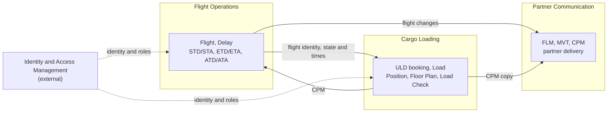
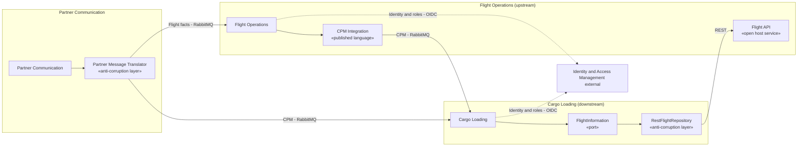
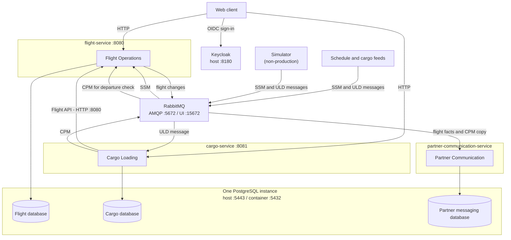

# Air Freight Operations

An airline carries cargo between airports on a fixed flight schedule. Flight planners record delays, their causes, and actual departure and arrival times. Load planners assign booked containers and pallets (ULDs) to aircraft positions, check the load, and finalize it.

Flight schedules and cargo bookings arrive from existing data feeds. The system keeps flight and load information current and creates standard IATA messages for other parties at the appropriate moments, even before any recipients are connected.

## 1. Subdomains

| Subdomain | Type | Why |
| --- | --- | --- |
| Flight Planning | Supporting | It keeps flight times and delays reliable so operations can respond. |
| Freight Loading | Core | Planning, checking and finalising the cargo load is central to this air-freight system. |
| Partner Messaging | Supporting | It creates the required flight and load messages for external parties when relevant events occur. |
| Identity and Access Management (IAM)          | Generic | Signing users in is a common problem handled by Keycloak; each operational context still enforces its own action rules. |

## 2. Bounded contexts

## 3. Ubiquitous language

The same term can have a different role in each context. A dash means the term is not part of that context's model.

| Term | Flight Operations | Cargo Loading | Partner Communication | Identity and Access Management  |
| --- | --- | --- | --- | --- |
| Flight | One dated flight with number, airports, registration and times | Reference for bookings and loads | Identified in flight and load messages | — |
| STD / STA | Immutable scheduled departure / arrival | STD helps define the loading period | Included in FLM | — |
| ETD / ETA | Estimates derived from delays | ETD helps end the loading period | Changes trigger MVT-ED / MVT-EA | — |
| ATD / ATA | Actual takeoff / landing times | — | Registration triggers MVT-AD / MVT-AA | — |
| Delay | Minutes, IATA reason and description | — | Estimate changes trigger MVT messages | — |
| Departed | Flight has an ATD | Loading can no longer change | — | — |
| Landed | Flight has an ATA | — | — | — |
| SSM | Schedule message that announces flights | — | — | — |
| ULD | — | Container or pallet with code, weight and destination | Described in a CPM when positioned | — |
| Booked | — | Announced for a flight; not necessarily loaded | — | — |
| Loading position | — | Place on the aircraft deck | Included in a CPM | — |
| Load | — | ULDs assigned to positions | Described in a CPM | — |
| Floor plan | — | Positions for an aircraft type and cargo-door location | — | — |
| Loading period | — | Window when the load may change | — | — |
| Load check | — | Whole-load rule; hard failure blocks finalization, soft failure warns | — | — |
| Finalized load | CPM must be processed before departure | Checked, frozen load | Described by its CPM copy | — |
| ULD message | — | Incoming announcement of one booking | — | — |
| Telegram (MVT) | Reports estimated or actual flight movement | — | IATA text message | — |
| FLM | Created for a new flight | — | Outgoing Flight Message for partners | — |
| CPM | Receipt and processing unlocks departure | Created after finalization | Outgoing copy for partners | — |
| Operations user | Can view flight information | Can view cargo information | — | User with one of the two planner roles |
| Flight planner | May change delays and record ATD/ATA, never STD/STA | Read-only | — | Role assigned to a user |
| Load planner | Read-only | May position, check and finalize within the permitted state and period | — | Role assigned to a user |

## 4. Context map

Arrows show dependencies: downstream → upstream.

| Relationship |Pattern | Why |
| --- | --- | --- |
| Flight Operations -> Cargo Loading | Open Host Service, Published Language; Cargo anti-corruption layer | Flight Operations exposes a flight-information contract; Cargo Loading translates it into its own model. |
| Cargo Loading -> Flight Operations | Published Language; Flight anti-corruption layer | Cargo Loading publishes CPM; Flight Operations translates it into its departure prerequisite. |
| Flight Operations -> Partner Communication | Published Language | Partner Communication uses flight facts to create FLM/MVT notifications. |
| Cargo Loading -> Partner Communication | Published Language | Partner Communication receives its own CPM copy for partner delivery. |

## 5. Deployment

One PostgreSQL instance contains three separate databases, one owned by each service. Services exchange business data through contracts rather than reading another service's database.

## 6. Tactical design: first bounded context

_TODO_

## 7. Tactical design: second bounded context

_TODO_

## 8. Layering

_TODO_

## 9. Running it

_TODO_
